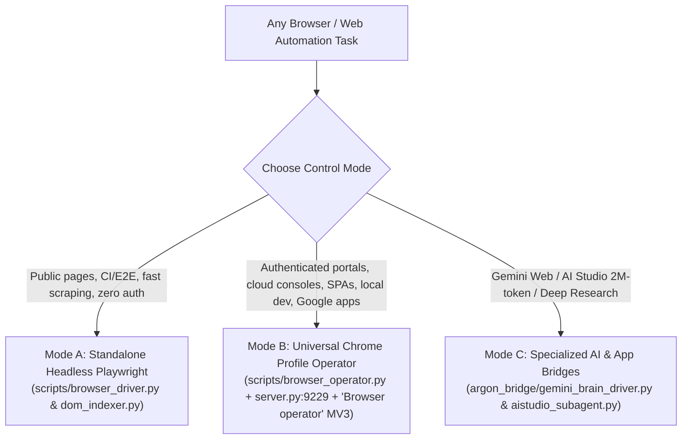

# Browser Operator — Generalized Full Browser Operation Suite v3.0

> [!IMPORTANT]
> ⛔ **EXECUTION-FIRST MANDATE (ZERO-PASSIVE-READING)**:
> Bundled scripts in `scripts/` and `argon_bridge/` are **executable software tools**, NOT reading material.
> When this skill is triggered, **EXECUTE the relevant script immediately** via `run_command`.
> **STRICT PROHIBITION**: NEVER call `view_file` on bundled scripts or explain their source code to the user unless explicitly ordered to edit or debug the script itself.
> Execute scripts from **ANY project workspace** via their absolute path:
> - `python <BRAIN_ROOT>\.agents\skills\browser-operator\scripts\browser_operator.py <subcommand> ...`
> - `python <BRAIN_ROOT>\.agents\skills\browser-operator\scripts\browser_driver.py <inspect|read|run> ...`
> - `python <BRAIN_ROOT>\.agents\skills\browser-operator\argon_bridge\<script_name> ...`

---

## 1. Control Plane Decision Matrix (Mode A / Mode B / Mode C)



| Mode | Entry Script | Best For | Key Advantage |
|---|---|---|---|
| **Mode A** (Headless Playwright) | `scripts/browser_driver.py`, `scripts/dom_indexer.py` | Public sites, unauthenticated scraping, CI E2E tests | Zero profile side-effects, stealth WebGL/navigator spoofing, `[id]` screenshot badges |
| **Mode B** (Multi-Profile Real Chrome) | `scripts/browser_operator.py` + `argon_bridge/server.py` | **ANY** authenticated website (GCP/AWS/Azure, GitHub, Jira, Stripe, college portals, e-commerce, local dev) | Authentic user Chrome profiles (`Profile 7/8/9/13/14/16`), cookies preserved, no guest-mode traps |
| **Mode C** (Specialized AI Bridges) | `argon_bridge/gemini_brain_driver.py`, `aistudio_subagent.py` | Gemini Web (`Argon` + High Thinking + Deep Research) & Google AI Studio (`2M` context, App Builder, Gallery) | Shared 6-account Pro fleet leases, `/usage` telemetry, Ground-Truth Action-Bar harvesting |

> **ANTI-GUEST-PROFILE RULE**: Never fall back to `mcp_chrome-devtools` or ephemeral guest Playwright browsers when a task targets a user Chrome profile, logged-in account, or authenticated portal. Always use Mode B (`browser_operator.py --profile "..."`).

---

## 2. Core Generalized Capabilities

### 2.1 Tab & Window Lifecycle (`status`, `tabs`, `new-tab`, `switch-tab`, `close-tab`, `back`, `forward`, `reload`)
- **Auto-Boot & Stale-Socket Healing**: `browser_operator.py` auto-starts `argon_bridge/server.py` (`127.0.0.1:9229`) and launches the target Chrome profile if disconnected. `server.py` prunes closed sockets and routes to the freshest live extension WebSocket (`max(last_ping)`).
- **Focus-Safe Parallel Tabs (`--tab <tabId>`)**: Pass `--tab <tabId>` on commands to target a specific tab without stealing window focus, enabling safe concurrent multi-tab workflows (e.g., Tab 1 uploads while Tab 2 reads/solves).
- **Low-RAM Single-Tab Advisory**: On memory-constrained hosts (12GB RAM), prefer `--reuse` on `new-tab` or close ephemeral tabs when done.

### 2.2 Zero-Vision Observation & Structured Extraction (`observe`, `read`, `meta`, `logs`, `storage`, `screenshot`)
- **Numeric Action Space (`observe`)**: Indexes interactive elements (`[1]`, `[2]`, ...) across the **main document, open Shadow DOM roots, and accessible same-origin iframes**, translating coordinates to top-level viewport `(x, y)` and tagging `[offscreen]` items.
- **High-Density Extraction (`read`)**: Extracts `markdown`, `tables`, `kpis`, `links`, `forms` (password values masked), `meta`, or `all` JSON—optionally scoped to `--selector <css>`.
- **Opt-In Console & Network Error Telemetry (`logs`)**: Explicitly enable via `logs --enable` (attaches CDP `Log`/`Network`/`Runtime` ring buffer of 100 entries per tab) so stealth sessions never pay `Runtime.enable` detection overhead unless requested.
- **Annotated Screenshots (`screenshot --badges --full-page`)**: Captures PNG/WebP/JPEG viewports or full pages, optionally overlaying `[id]` badges and cleaning them up immediately.

### 2.3 Trusted CDP Interaction & SPA Reliability (`click`, `hover`, `type`/`fill`, `select`, `check`/`uncheck`, `press`/`hotkey`, `scroll`, `scroll-find`)
- **Single Trusted CDP Clicks (`isTrusted: true`)**: Dispatches `mouseMoved` -> `mousePressed` -> `mouseReleased` with viewport clamping (`0 <= x <= innerWidth`, `0 <= y <= innerHeight`) and **zero duplicate `el.click()` double-firing**. Supports `--role`, `--name`, `--button left|right|middle`, `--double`, and `--stealth` (cubic Bézier cursor trajectory).
- **React / Angular-Safe Input (`type` / `fill`)**: Clears controlled inputs via `HTMLInputElement.prototype` / `HTMLTextAreaElement.prototype` native value setters + `input`/`change` events + `Ctrl+A` `Backspace`, then inserts text via CDP `Input.insertText` or cadenced `--stealth` keystrokes.
- **Dropdowns & Toggles (`select`, `check`, `uncheck`)**: Handles native `<select>` elements and custom ARIA/Material `[role="combobox"]` / `mat-select` dropdowns; `check`/`uncheck` inspect `checked`/`aria-checked` first for idempotency.
- **Arbitrary Key Chords (`press`, `hotkey`, `accelerator`)**: Parses arbitrary combinations (`Enter`, `Escape`, `Tab`, `Control+Shift+R`, `Alt+c`, `Control+Alt+a`, `Meta+k`, `.`) into CDP `modifiers` and virtual key codes.
- **Virtualized Container Scanning (`scroll-find`)**: Steps `.scrollTop` incrementally inside virtualized containers (`.a-Cd-oa`, `[role="main"]`, AG Grid) with mutation settle pauses until the target mounts, then centers it via `scrollIntoView({block:'center'})`.
- **SPA Visibility & Mount-Wait Invariants**: Never rely on `el.offsetParent !== null` for `position: fixed` modals (e.g., Ant Design `.ant-modal`, Material dialogs)—check `offsetWidth > 0 && getComputedStyle(el).display !== 'none'`, and use `wait --selector/--text/--url/--gone/--idle` before reading dynamic badges.

### 2.4 Multi-Tier Upload, Dialogs & Security Circuit Breakers (`upload`, `dialog`, `check-auth`, `run-goal`)
- **3-Tier File Upload (`upload`)**:
  1. Direct CDP `DOM.setFileInputFiles` on `<input type="file">` (including pierced shadow roots).
  2. `window.showOpenFilePicker = undefined` override + CDP `Page.setInterceptFileChooserDialog` (`--intercept`).
  3. Trigger via CSS/text (`--trigger`) or keyboard accelerator (`--accelerator`).
- **JS Dialog Control (`dialog`)**: Accept or dismiss `alert`/`confirm`/`prompt`/`beforeunload` via `Page.handleJavaScriptDialog`.
- **2FA / CAPTCHA Circuit Breaker (`check-auth` & `run-goal`)**: Detects OTP inputs (`#authCode`, `autocomplete="one-time-code"`), identity prompts (`"Verify your identity"`, `"Confirm it is still you"`), and CAPTCHAs (Turnstile, reCAPTCHA, hCaptcha). `run-goal` automatically checks before every step and halts cleanly with **exit code 2** if triggered.
- **Single-Process Batch Goals (`run-goal`)**: Executes N heterogeneous steps (`goto`, `wait`, `observe`, `click`, `hover`, `type`, `select`, `check`, `press`, `scroll`, `scroll-find`, `upload`, `dialog`, `screenshot`, `read`, `assert`, `eval`, `sleep`) in one process call (`--actions` or `--actions-file`).

---

## 3. CLI Command Reference

### 3.1 Mode B: Universal Chrome Multi-Profile Operator (`scripts/browser_operator.py`)

```powershell
# --- Fleet, Tabs & History ---
python <BRAIN_ROOT>\.agents\skills\browser-operator\scripts\browser_operator.py status
python <BRAIN_ROOT>\.agents\skills\browser-operator\scripts\browser_operator.py tabs --profile "Profile 8"
python <BRAIN_ROOT>\.agents\skills\browser-operator\scripts\browser_operator.py new-tab "https://github.com" --profile "Profile 8" --reuse
python <BRAIN_ROOT>\.agents\skills\browser-operator\scripts\browser_operator.py switch-tab --url "console.cloud.google.com" --profile "Profile 8"
python <BRAIN_ROOT>\.agents\skills\browser-operator\scripts\browser_operator.py close-tab --tab 12345 --profile "Profile 8"
python <BRAIN_ROOT>\.agents\skills\browser-operator\scripts\browser_operator.py reload --bypass-cache --profile "Profile 8"

# --- Navigation & Waiting ---
python <BRAIN_ROOT>\.agents\skills\browser-operator\scripts\browser_operator.py goto "https://console.cloud.google.com/billing" --profile "Profile 8" --wait-until settle
python <BRAIN_ROOT>\.agents\skills\browser-operator\scripts\browser_operator.py wait --text "Cost breakdown" --timeout 10 --profile "Profile 8"
python <BRAIN_ROOT>\.agents\skills\browser-operator\scripts\browser_operator.py wait --gone ".loading-spinner" --timeout 15 --profile "Profile 8"
python <BRAIN_ROOT>\.agents\skills\browser-operator\scripts\browser_operator.py wait --idle --timeout 10 --profile "Profile 8"

# --- Observation, Extraction & Telemetry ---
python <BRAIN_ROOT>\.agents\skills\browser-operator\scripts\browser_operator.py observe --profile "Profile 8" --viewport-only
python <BRAIN_ROOT>\.agents\skills\browser-operator\scripts\browser_operator.py observe --profile "Profile 8" --screenshot "temp_read/annotated.png" --badges
python <BRAIN_ROOT>\.agents\skills\browser-operator\scripts\browser_operator.py read --profile "Profile 8" --format all -o temp_read/page_data.json
python <BRAIN_ROOT>\.agents\skills\browser-operator\scripts\browser_operator.py read --profile "Profile 8" --format tables --selector "main"
python <BRAIN_ROOT>\.agents\skills\browser-operator\scripts\browser_operator.py meta --profile "Profile 8"
python <BRAIN_ROOT>\.agents\skills\browser-operator\scripts\browser_operator.py logs --enable --profile "Profile 8"
python <BRAIN_ROOT>\.agents\skills\browser-operator\scripts\browser_operator.py logs --level error --profile "Profile 8"
python <BRAIN_ROOT>\.agents\skills\browser-operator\scripts\browser_operator.py storage --type cookies --profile "Profile 8"
python <BRAIN_ROOT>\.agents\skills\browser-operator\scripts\browser_operator.py screenshot -o temp_read/screen.png --full-page --profile "Profile 8"

# --- Generalized Interactions ---
python <BRAIN_ROOT>\.agents\skills\browser-operator\scripts\browser_operator.py click 2 --profile "Profile 8"
python <BRAIN_ROOT>\.agents\skills\browser-operator\scripts\browser_operator.py click --role button --name "Save changes" --stealth --profile "Profile 8"
python <BRAIN_ROOT>\.agents\skills\browser-operator\scripts\browser_operator.py hover "Account" --profile "Profile 8"
python <BRAIN_ROOT>\.agents\skills\browser-operator\scripts\browser_operator.py type 3 "Compute Engine" --enter --profile "Profile 8"
python <BRAIN_ROOT>\.agents\skills\browser-operator\scripts\browser_operator.py select "#region" "us-central1" --profile "Profile 8"
python <BRAIN_ROOT>\.agents\skills\browser-operator\scripts\browser_operator.py check "#agree-terms" --profile "Profile 8"
python <BRAIN_ROOT>\.agents\skills\browser-operator\scripts\browser_operator.py press "Control+Shift+R" --profile "Profile 8"
python <BRAIN_ROOT>\.agents\skills\browser-operator\scripts\browser_operator.py scroll-find --container ".a-Cd-oa" --text "Report.pdf" --profile "Profile 7"
python <BRAIN_ROOT>\.agents\skills\browser-operator\scripts\browser_operator.py upload "C:\path\to\doc.pdf" --profile "Profile 7"
python <BRAIN_ROOT>\.agents\skills\browser-operator\scripts\browser_operator.py upload "C:\path\to\doc.pdf" --intercept --trigger "Upload files" --profile "Profile 7"
python <BRAIN_ROOT>\.agents\skills\browser-operator\scripts\browser_operator.py dialog --accept --profile "Profile 8"
python <BRAIN_ROOT>\.agents\skills\browser-operator\scripts\browser_operator.py check-auth --profile "Profile 8"

# --- Multi-Step Batch Goal Pipeline ---
python <BRAIN_ROOT>\.agents\skills\browser-operator\scripts\browser_operator.py run-goal "Inspect SKU Breakdown" --profile "Profile 8" --actions '[
  {"action": "wait", "text": "Cost breakdown", "timeout": 8},
  {"action": "click", "text": "Breakdown"},
  {"action": "read", "format": "tables", "output": "temp_read/sku_table.json"}
]'
```

### 3.2 Mode A: Standalone Headless Playwright (`scripts/browser_driver.py` & `dom_indexer.py`)

```powershell
# Inspect public URL and output numeric [id] action space
python <BRAIN_ROOT>\.agents\skills\browser-operator\scripts\browser_driver.py inspect "<url>"
python <BRAIN_ROOT>\.agents\skills\browser-operator\scripts\browser_driver.py inspect "<url>" --screenshot "temp_read/page.png" --badges

# Extract clean markdown text, tables, and links
python <BRAIN_ROOT>\.agents\skills\browser-operator\scripts\browser_driver.py read "<url>" --json

# Execute headless action sequence (click, hover, type, select, press, scroll, wait, read)
python <BRAIN_ROOT>\.agents\skills\browser-operator\scripts\browser_driver.py run "<url>" --actions '[{"action":"type","id":1,"val":"PostgreSQL","enter":true},{"action":"read"}]'

# Lightweight DOM indexer
python <BRAIN_ROOT>\.agents\skills\browser-operator\scripts\dom_indexer.py inspect "<url>"
```

### 3.3 Mode C: Specialized Argon & AI Studio Bridges (`argon_bridge/`)

Operates across the shared 6-account Google One AI Premium fleet (`Profile 14`, `13`, `16`, `7`, `8`, `9`) with lease TTLs (`300s` standard, `900s` Deep Research), `25s` heartbeats, `/usage` auditing, Pre-Send Model Gate (`Argon` + `High`), and Ground-Truth Action-Bar harvesting:

```powershell
# 1. Audit live Gemini quota on target profile
python <BRAIN_ROOT>\.agents\skills\browser-operator\argon_bridge\gemini_brain_driver.py --profile "Profile 14" --usage

# 2. Query Gemini 4 Argon (Tier 1 $0 Browser Bridge via deep-thinking wrapper)
python <BRAIN_ROOT>\.agents\skills\deep-thinking\scripts\consult_argon.py "Your prompt" --profile "Profile 13" --thinking High
python <BRAIN_ROOT>\.agents\skills\deep-thinking\scripts\consult_argon.py "Followup" --session-id "task_1" --continue --profile "Profile 13"
python <BRAIN_ROOT>\.agents\skills\deep-thinking\scripts\consult_argon.py "Deep research topic" --deep-research --profile "Profile 14"

# 3. Check live multi-agent profile leases
python -c "import urllib.request, json; print(json.dumps(json.loads(urllib.request.urlopen('http://127.0.0.1:9229/locks').read()), indent=2))"

# 4. Google AI Studio (2M-token context, <> Get code, App Builder, Showcase Gallery)
python <BRAIN_ROOT>\.agents\skills\browser-operator\argon_bridge\aistudio_subagent.py "Analyze invariants" -f constraints.md project_map.md --profile "Profile 14" --model "gemini-4-argon"
python <BRAIN_ROOT>\.agents\skills\browser-operator\argon_bridge\aistudio_subagent.py --surface playground --model gemini-4-argon --get-code --get-code-output temp_read/sdk.py
python <BRAIN_ROOT>\.agents\skills\browser-operator\argon_bridge\aistudio_subagent.py "Three.js visualizer" --surface apps --profile "Profile 14"
python <BRAIN_ROOT>\.agents\skills\browser-operator\argon_bridge\aistudio_subagent.py --surface gallery --search-gallery "Argon" --profile "Profile 14"
```

---

## 4. Cross-Skill Integration Contracts

- **`external-resource`**: Stages local assets and verifies non-zero size before acquiring a `browser-operator` lease (`ttl=300`, `25s` heartbeat) under the Prompt-First File Attachment Protocol.
- **`web-search-orchestrator`**: Runs Deep Research via `deep_research=True` (`ttl=900`, `25s` heartbeat), sweeping orphan tabs in `finally` and harvesting via Ground-Truth Action-Bar detection.
- **`deep-thinking`**: Drives multi-turn reasoning via sticky `session_id` routing (`--continue`, `auto_clean=False`), finalizing with `--clean` only after verified synthesis.

---

## 5. Operational Invariants for Subagents

1. **No Raw Browser / Guest Fallback**: Never spawn unmanaged guest Chrome/Playwright or `mcp_chrome-devtools` when a user Chrome profile or authenticated session is required.
2. **No `/teamwork` Theater on Live Browser Ops**: Do not spawn multi-tier planning hierarchies for real-time interactive browser tasks; execute directly with `browser_operator.py` / `run-goal` or a focused single-runner script.
3. **Focus-Safe `--tab` Isolation & Single-Tab Low-RAM Limit**: Pass explicit `--tab <tabId>` during concurrent tab tasks, and close ephemeral tabs when finished.
4. **Viewport Clamping & No Double-Clicks**: Never click elements outside viewport bounds, and never fire both `el.click()` and CDP `mousePressed`/`mouseReleased` on the same interaction.
5. **Modal Visibility & Mount-Wait Polling**: Never use `offsetParent !== null` on `position: fixed` overlays; check `offsetWidth > 0 && getComputedStyle(el).display !== 'none'` and wait for lazy SPA containers before reading status badges.
6. **2FA / CAPTCHA Circuit Breaker & TOTP Replay Guard**: Halt all mutating actions immediately on 2FA/CAPTCHA detection (exit code `2`). For authorized RFC 6238 TOTP self-automation, enforce at most 1 code per 30s step (`last_used_totp_step`) to prevent account lockouts.
7. **Argon Bridge Protocol Invariants (Mode C)**: Respect 6-profile fleet leases (`agent_id`, `session_id`), Prompt-First CDP file uploads, zero character-length floors (harvest on `👍 👎 📋` action bar + stopped generation), and explicit `--clean` only when finalized.
8. **Subagent Model Invariant**: When delegating browser tasks to subagents, always use `TypeName='self'` and `Model='inherit'` (never `DeepCoder`/`DeepInvestigator` or `Model='flash'`).
