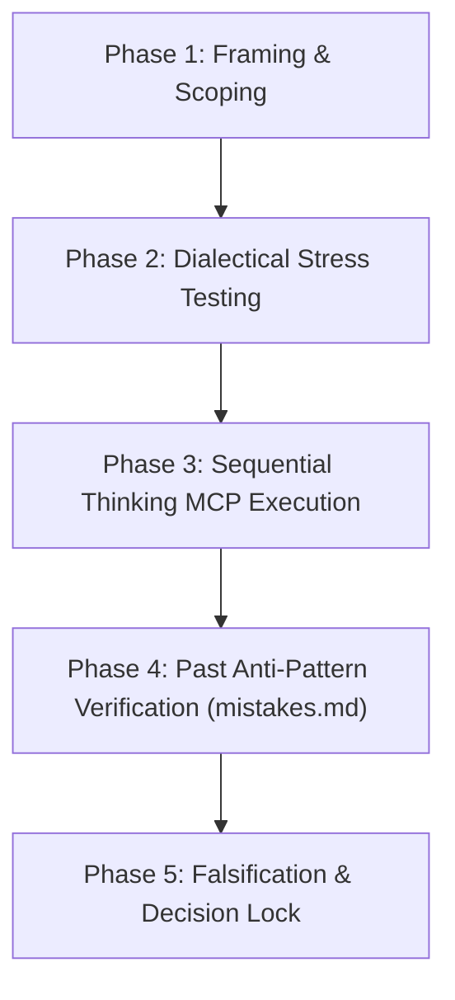

# Deep Thinking 3.0: Unified Cognitive Architecture & Reasoning Core

> [!IMPORTANT]
> ⛔ **EXECUTION-FIRST MANDATE (ZERO-PASSIVE-READING)**:
> Bundled scripts in `scripts/` are **executable software tools**, NOT reading material.
> When this skill is triggered, **EXECUTE the relevant script immediately** via `run_command`.
> **STRICT PROHIBITION**: NEVER call `view_file` on scripts in `scripts/` or explain their source code to the user unless explicitly ordered to edit or debug the script itself.
> Universal scripts can and must be executed from **ANY project workspace** by calling their absolute path:
> `python <BRAIN_ROOT>\.agents\skills\deep-thinking\scripts\<script_name> ...`

> **Unified Autonomous Cognitive Reasoning & Systems Architecture Suite**  
> **Integrates Sequential Thinking MCP, Dialectical Stress-Testing, Google Spark Prompt Synthesis & 3-Tier Cloud Storage Blueprinting**

---

## 1. When to Activate Deep Thinking
Activate this protocol whenever facing:
- **Architectural Ambiguity**: Deciding between alternative infrastructures (Lambda vs. VM vs. Cloudflare Workers, storage tiers, vector stores).
- **Brainstorming & Feature Design**: Transforming vague requests into production-ready blueprints.
- **Tricky Root Cause Analysis**: Bugs with cascading failures, subtle race conditions, or unexplained HTTP 500/524 errors.
- **High-Stakes Operations**: Modifying production database schemas, Cloudflare tunnels, or spending cloud GPU credits.
- **Explicit Directives**: Slash commands `/boost`, `/goal`, or requests to *"think deeply"*, *"brainstorm"*, or *"architect"*.

---

## 2. Universal Storage Tier Boundaries (MANDATORY INVARIANT)

When architecting any system or feature, strictly follow this three-tier cloud storage hierarchy:

| Tier / Provider | Free Tier Limit | Permitted Data Types | STRICTLY FORBIDDEN |
|---|---|---|---|
| **Tier 1: Lightweight Metadata (Supabase)** | **500 MB DB Limit** | • User Auth & `user_metadata`<br>• Lightweight user profile & theme preferences<br>• Text/code notes & lightweight chat history<br>• Minimal system telemetry logs | 🛑 **NEVER store rich-text JSON ASTs, large documents, PDFs, DOCX files, images, or large binary payloads.** |
| **Tier 2: Bulk Object Vault (Cloudflare R2)** | **10 GB Storage / $0 Egress** | • Document Editor full rich-text JSON ASTs<br>• Document version revisions & snapshots<br>• PDF, DOCX, audio, and media file uploads<br>• Large state caches and bulk export archives | 🛑 Do not use for low-latency relational SQL foreign-key queries. |
| **Tier 3: Relational & Vector Compute (Azure PostgreSQL)** | **Standard_B1ms 750h/mo Free** | • AI Vector Embeddings (`pgvector` RAG)<br>• Heavy academic taxonomy & learning paths<br>• High-volume cognitive telemetry & prompt caches | 🛑 Do not store global public auth passwords or assign paid public IPv4 addresses. |

---

## 3. The 5-Phase Cognitive Loop



### Phase 1: Problem Framing & Scoping
1. **Identify the True Core Objective**: Separate root requirements from surface-level symptoms or assumptions.
2. **Surface Hidden Invariants**: Check active project rules (`context/constraints.md`, `context/resources.md`).
3. **Bound the Problem Space**: Explicitly identify what is in-scope vs out-of-scope.

### Phase 2: Dialectical Multi-Perspective Stress Testing
Evaluate the proposal through 4 adversarial cognitive lenses:
- **The Architect**: Is this solution modular, minimal, and aligned with long-term patterns? Does it introduce unnecessary abstractions or external dependencies?
- **The Adversary / Chaos Engineer**: What happens if the network drops mid-request? If the API returns a 429? If payload is malformed? If concurrency spikes to 1,000 req/s?
- **The Cost & Resource Guard**: Does this consume paid resources? Does it exceed Free Tier limits (500MB DB, 64GB SSD, 100k requests)? Is intra-region egress zero?
- **The User Experience Auditor**: Does this eliminate robotic slop? Are latency, feedback, and error messages crisp, fast, and actionable?

### Phase 3: Dynamic Sequential Thinking MCP Execution
When working through non-linear reasoning, call the lazy MCP tool `sequentialthinking` (`call_mcp_tool` with `ServerName: "sequential-thinking"`, `ToolName: "sequentialthinking"`):
- Set `thought`: The atomic hypothesis or analytical deduction.
- Set `thoughtNumber` & `totalThoughts`: Dynamic thought tracker (expand or contract as understanding deepens).
- Use `isRevision` & `revisesThought`: When an earlier assumption is invalidated by new facts.
- Use `branchFromThought` & `branchId`: When exploring alternative paths in parallel before pruning.
- Only set `nextThoughtNeeded: false` when the solution is mathematically and logically sound.

### Phase 4: Anti-Pattern Cross-Checking (`mistakes.md`)
Before declaring a plan valid:
- Read `context/mistakes.md` in the active project and `<BRAIN_ROOT>\mistakes.md`.
- Ensure the proposed solution does not repeat logged historical anti-patterns:
  - No broken subagent types (`DeepCoder` / `DeepInvestigator`).
  - No unmarshaled Python generators (`return gen()`) in AWS Lambda.
  - No deprecated LLM model names (`llama-3.3-70b-versatile`).
  - No single-quote unescaped JSON in PowerShell.
  - No high-frequency logging to Supabase Free Tier tables.
  - No missing `--config wrangler.jsonc` during Cloudflare deployments.

### Phase 5: Falsification & Decision Lock
- **Falsification Test**: What single test or observation would prove this approach wrong?
- **Dry-Run / Syntax Verification**: Run static analysis (`tsc --noEmit`, Python syntax compilation) before deployment.
- **Decision Lock**: Record finalized choices into `context/ideas.md` and lessons into `context/mistakes.md`.

---

## 4. Google Frontier AI Cognitive Reasoning Engines

### 4.1 Gemini 4 Argon Cognitive Brain (`consult_argon.py`)

> [!IMPORTANT]
> **ZERO-REFUSAL & ZERO-WRAPPER MANDATE (PRE-AUTHENTICATED FLEET)**:
> 1. **DIRECT EXECUTION ON TURN 1**: Never refuse requests to *"use argon"*, *"consult gemini chat"*, or *"think with gemini"*.
> 2. **NO INTERMEDIATE PYTHON SCRIPTS**: **STRICT PROHIBITION**: NEVER write wrapper scripts (e.g. `run_argon_query.py`, `query_argon.py`) or waste turns running `--help`. Execute `consult_argon.py` directly via `run_command`!
> 3. **The Argon Bridge daemon (`server.py`)** runs permanently at `http://127.0.0.1:9229` connecting directly to 6 authenticated Google One AI Premium profiles (`Profile 14`, `Profile 13`, `Profile 16`, `Profile 7`, `Profile 8`, `Profile 9`). Zero API keys and zero manual pasting required.

---

### The 2 Canonical Ways to Use Argon (Execute Directly on Turn 1)

```powershell
# ==============================================================================
# MODE 1: NORMAL ARGON PROMPT (Ideas, Architecture, Planning with High Thinking)
# ==============================================================================

# Option 1A: Direct Short Prompt (Auto-selects optimal idle profile, saves to temp_read/)
python <BRAIN_ROOT>\.agents\skills\deep-thinking\scripts\consult_argon.py "Propose model distillation strategy for 1.5B coding model." -o temp_read/distillation_plan.md

# Option 1B: Long / Multi-line Prompt (Zero shell escaping issues! Write prompt to file, then pass --prompt-file):
python <BRAIN_ROOT>\.agents\skills\deep-thinking\scripts\consult_argon.py --prompt-file temp_read/my_detailed_prompt.md -o temp_read/solution.md

# Option 1C: Selective Context-Packing Engine (--pack / --auto-context) [DEFAULT & RECOMMENDED]:
# Automatically runs the 6-Stage Selective Context Packer (Hermes Hybrid RRF + Top-K BM25/N-gram slices of constraints/ideas/mistakes + AST code slicing),
# compiles temp_read/argon_context_bundle.md (~96% noise reduction vs raw files), and attaches it via -f into Gemini:
python <BRAIN_ROOT>\.agents\skills\deep-thinking\scripts\consult_argon.py "Review the attached files for architectural anti-patterns and performance bottlenecks." --pack src/engine.py:1-160 src/router.py#dispatch -o temp_read/argon_review.md

# Option 1D: Manual Context File Attachment (-f / --upload):
python <BRAIN_ROOT>\.agents\skills\deep-thinking\scripts\consult_argon.py "Review the attached spec." -f temp_read/custom_spec.md -o temp_read/argon_review.md

# Option 1E: Tier-2 Vertex AI API Route (ONLY when all 6 browser accounts hit quota OR user explicitly requests API):
python <BRAIN_ROOT>\.agents\skills\deep-thinking\scripts\consult_argon.py "Review the attached files" --pack src/engine.py --api -o temp_read/argon_api_review.md

# Option 1F: Multi-Turn Cognitive Dialogue (re-attaches to existing chat thread without creating new chat):
python <BRAIN_ROOT>\.agents\skills\deep-thinking\scripts\consult_argon.py "Initial design query" --session-id "task_arch" --no-clean
python <BRAIN_ROOT>\.agents\skills\deep-thinking\scripts\consult_argon.py "Critique the proposed consensus model" --session-id "task_arch" --continue --clean

# ==============================================================================
# MODE 2: ARGON DEEP RESEARCH (Exhaustive Grounded Investigation across 20+ Sources)
# ==============================================================================
python <BRAIN_ROOT>\.agents\skills\deep-thinking\scripts\consult_argon.py "Comprehensive comparison of pgvector vs Milvus vs Qdrant in 2026." --deep-research -o temp_read/vector_db_research.md

# ==============================================================================
# FLEET OBSERVABILITY (Optional: Inspect live status & quota across all 6 profiles)
# ==============================================================================
python <BRAIN_ROOT>\.agents\skills\deep-thinking\scripts\consult_argon.py --status
```

#### A. The Context File Preparation & Upload Protocol (Context Bundling)
Large codebases, complex schemas, stack traces, and multi-file architecture questions must NOT be jammed into tiny single-sentence prompts. Agents must proactively bundle full context into an artifact and attach it directly into Argon's multi-million token context window:

1. **Step 1: Context File Synthesis (`temp_read/context_bundle.md`)**:
   Before dispatching to Argon, write a structured Markdown context file in the active project's `temp_read/` directory bundling:
   - Exact problem statement, performance goals, and constraints (`constraints.md`, 0 paid public IPs, free tier).
   - Relevant codebase excerpts (interfaces, data schemas, functions).
   - Error stack traces, logs, or failing test outputs.
   - Lessons from `mistakes.md` to prevent past regressions.
2. **Step 2: Programmatic Execution with File Attachment**:
   Execute `consult_argon.py` passing `-f <path_to_context_file>`:
   ```powershell
   python <BRAIN_ROOT>\.agents\skills\deep-thinking\scripts\consult_argon.py "Review the attached context bundle. Propose the optimal architecture and step-by-step implementation." -f temp_read/context_bundle.md -o temp_read/argon_solution.md
   ```
3. **Step 3: Multi-Agent Concurrency & Shared Fleet Observability**:
   - **Universal Compute Fleet**: All 6 Google One AI Premium profiles form a shared fleet accessible to all agents across any task or workspace—never artificially hardcoded to specific projects.
   - **Live Observability Table**: Run `python <BRAIN_ROOT>/.agents/skills/deep-thinking/scripts/consult_argon.py --status` to inspect live fleet observability: which profiles are IDLE vs BUSY, who is holding them, what task they are running, and their current 5-hour and weekly quota usage %.
   - **Autonomous Selection**: Agents can explicitly select a profile (`--profile "Profile 8"`) or omit it to let the system auto-pick the optimal idle profile with the lowest usage %.
   - **Collision Prevention**: If a requested profile is busy with another agent, the system logs the active holder and remaining TTL, and automatically routes to an idle profile with lower usage to prevent tab and typing collisions.
4. **Step 4: Low-RAM System Invariant (Single-Tab Protection)**:
   To protect systems with low RAM (~3GB free) from out-of-memory browser crashes:
   - The driver strictly reuses the single existing Gemini tab per profile window.
   - Never spawn unnecessary new tabs.
   - Any temporary diagnostic tab (e.g. `/usage`) is immediately closed upon reading.
5. **Step 5: Pre-Send Model Verification Gate**:
   - The driver strictly verifies that `button.input-area-switch` confirms `Argon` and `High` BEFORE sending.
   - If the UI is on `Flash`, it automatically opens the picker, selects `4 Argon` + `High Thinking`, and confirms before dispatching text.
   - It will NEVER silently submit queries on Flash.

```powershell
# 1. Inspect live profile leases and project bindings
python <BRAIN_ROOT>\.agents\skills\deep-thinking\scripts\consult_argon.py --status

# 2. Audit live Gemini quota on target profile without sending prompts
python <BRAIN_ROOT>\.agents\skills\deep-thinking\scripts\consult_argon.py --profile "Profile 14" --usage

# 3. Standard cognitive consultation with High Thinking (auto-selects optimal idle profile)
python <BRAIN_ROOT>\.agents\skills\deep-thinking\scripts\consult_argon.py "Analyze architectural trade-offs between Cloudflare Workers and AWS Lambda for real-time WebSocket state." --thinking High

# 4. Context-Bundled Consultation
python <BRAIN_ROOT>\.agents\skills\deep-thinking\scripts\consult_argon.py "Review these files for architectural anti-patterns, race conditions, and memory leaks." -f temp_read/context_bundle.md -o temp_read/argon_review.md

# 5. Multi-Turn Cognitive Dialogue (re-attaches to existing chat thread without creating new chat)
python <BRAIN_ROOT>\.agents\skills\deep-thinking\scripts\consult_argon.py "Initial design query" --session-id "task_arch"
python <BRAIN_ROOT>\.agents\skills\deep-thinking\scripts\consult_argon.py "Critique the proposed consensus model" --session-id "task_arch" --continue

# 6. Comprehensive grounded investigation via Gemini Deep Research (900s TTL + auto-confirms research plan card)
python <BRAIN_ROOT>\.agents\skills\deep-thinking\scripts\consult_argon.py "Comprehensive comparison of pgvector vs Milvus vs Qdrant in 2026." --deep-research -o temp_read/vector_db_research.md

# 7. Finalize multi-turn task and cleanly delete chat from sidebar
python <BRAIN_ROOT>\.agents\skills\deep-thinking\scripts\consult_argon.py "Final synthesis and verify" --session-id "task_arch" --continue --clean
```

> [!CAUTION]
> 🛑 **2-TIER ARGON ROUTING, SIDEBAR HYGIENE & ZERO SCRIPT READING**:
> 1. **ZERO SCRIPT READING & ZERO WRAPPERS**: Subagents and agents MUST NEVER call `view_file` or `read_file` on `consult_argon.py` or `gemini_brain_driver.py`, and MUST NEVER create throwaway wrapper scripts (`run_argon_query.py`). Execute `consult_argon.py` directly via `run_command`.
> 2. **MANDATORY CONTEXT FILE ATTACHMENT (`-f`)**: When consulting Argon with context (architecture specs, code files, logs), ALWAYS bundle the context into `temp_read/<context>.md` and attach it via `-f temp_read/<context>.md`.
> 3. **DEFAULT SIDEBAR CHAT PURGE (`clean=True`)**: Automated runs automatically delete the temporary conversation from the Gemini sidebar after saving the response to `temp_read/` and auditing live 5h/weekly quota.
> 4. **2-TIER API FAILOVER POLICY (`--api`)**: Always use Tier 1 ($0-token Browser Bridge across the 6 Google One AI Premium profiles) by default. Use Tier 2 (`--api` / `<WORKSPACE_ROOT>\api_router\argon.py` on Vertex AI) **ONLY** if all 6 browser accounts have exhausted their 5-hour quota OR when the user explicitly requests to use the Argon API.

**Key Invariants for Argon Brain Consultation**:
- **Zero Manual Intervention**: The daemon and Chrome profile are auto-launched if not already running.
- **Pre-Flight Quota Audit**: Run `--usage` or check return telemetry. If current quota exceeds $80\%$, switch `--profile`.
- **Programmatic File Upload**: Uses CDP `DOM.setFileInputFiles` with Angular change detection events to upload entire files directly into the prompt box without text truncation.
- **Instant Response Harvesting**: Completes immediately upon action button arrival (`👍 👎 📋`) without artificial polling delays or arbitrary character length limits.
- **Safe Lifecycle Retention**: In `consult_argon.py`, `--clean` defaults to `True` so one-off automated queries do not clutter the sidebar. For multi-turn continuation (`--continue`) or visual debugging, pass `--no-clean` (`--keep`) on intermediate turns and omit it (or pass `--clean`) on the final turn.
- **Dynamic Lease Arbitration**: Inspects `http://127.0.0.1:9229/locks` before acquisition (`ttl=300s`, `25s` heartbeats) and auto-routes to an idle profile if the target is busy.

---

## 4.2 Cross-Skill Integration Contract

- **`browser-operator` Handshake**: Deep-thinking delegates all live browser, Gemini, and AI Studio actuation to `browser-operator` via `consult_argon.py`.
- **Sticky Multi-Turn Routing**: Multi-turn deliberations maintain state using a persistent `session_id`, holding profile affinity and avoiding unnecessary "New chat" clicks.
- **Single-Tab Low-RAM Limit**: Host systems have finite RAM. Never spawn unmanaged background tabs.
- **Terminal Cleanup Protocol**: Only pass `--clean` on the final turn when the overall architectural task is concluded.

### 4.3 Google Spark Self-Contained Prompt Synthesis

Because **Google Spark** operates without local filesystem access, formulate self-contained, high-density prompts with embedded schemas, metrics, and trade-off matrices:

```powershell
python <BRAIN_ROOT>\.agents\skills\deep-thinking\scripts\synthesize_spark_prompt.py \
  --topic "<topic>" \
  --constraints "<latency budgets, 0 paid public IPs, free tier>" \
  --schema "<data signatures, interfaces>" \
  --questions "<analytical questions>"
```

---

## 5. Cognitive Tools Suite: Brainstorming, Decision Engineering & Root Cause Analysis

Execute bundled scripts in `scripts/` to systematically drive brainstorming, architectural decision modeling, and recursive root-cause debugging:

### 5.1 Decision Engineering & Multi-Criteria Analysis (`decision_matrix.py`)
- **MCDA Scoring (WSM + TOPSIS + Pareto Frontier)**:
  `python <BRAIN_ROOT>\.agents\skills\deep-thinking\scripts\decision_matrix.py score --demo`
- **Failure Mode & Effects Analysis (FMEA RPN Calculator)**:
  `python <BRAIN_ROOT>\.agents\skills\deep-thinking\scripts\decision_matrix.py fmea --demo`
- **Trilemma Trade-Off Matrix (Latency vs Cost vs Quality)**:
  `python <BRAIN_ROOT>\.agents\skills\deep-thinking\scripts\decision_matrix.py tradeoff`

### 5.2 Structured Lateral Brainstorming (`structured_brainstorm.py`)
- **SCAMPER Lateral Ideation**:
  `python <BRAIN_ROOT>\.agents\skills\deep-thinking\scripts\structured_brainstorm.py scamper --topic "<system>"`
- **Six Thinking Hats Protocol (Edward de Bono)**:
  `python <BRAIN_ROOT>\.agents\skills\deep-thinking\scripts\structured_brainstorm.py sixhats --topic "<decision>"`
- **Munger Anti-Goal Inversion**:
  `python <BRAIN_ROOT>\.agents\skills\deep-thinking\scripts\structured_brainstorm.py inversion --topic "<feature>"`
- **TRIZ Software Contradiction Matrix**:
  `python <BRAIN_ROOT>\.agents\skills\deep-thinking\scripts\structured_brainstorm.py triz --contradiction autonomy_vs_safety`

### 5.3 Recursive Root Cause Analysis (`rca_drilldown.py`)
- **5-Whys Recursive Trace**:
  `python <BRAIN_ROOT>\.agents\skills\deep-thinking\scripts\rca_drilldown.py five_whys --demo`
- **Ishikawa 6M Fishbone Diagram**:
  `python <BRAIN_ROOT>\.agents\skills\deep-thinking\scripts\rca_drilldown.py ishikawa --demo`
- **Fault Tree Analysis (Boolean Gates & Cut Sets)**:
  `python <BRAIN_ROOT>\.agents\skills\deep-thinking\scripts\rca_drilldown.py fault_tree --demo`

### 5.4 Graph-of-Thoughts & Tree-of-Thoughts Controller (`graph_of_thoughts.py`)
Synthesizes ETH Zurich's `spcl/graph-of-thoughts` and Princeton/DeepMind's `princeton-nlp/tree-of-thought-llm`:
- **DAG Thought Aggregation**: Combines multiple thought nodes across orthogonal perspectives (architecture, reliability, cost).
- **Beam Search & Backtracking**: Explores reasoning frontiers with scalar evaluation, comparative voting, and dynamic pruning.
- **Run Live GoT Deliberation Demo**:
  `python <BRAIN_ROOT>\.agents\skills\deep-thinking\scripts\graph_of_thoughts.py --demo`
- **Generate Mermaid Diagram of Reasoning Graph**:
  `python <BRAIN_ROOT>\.agents\skills\deep-thinking\scripts\graph_of_thoughts.py --demo --mermaid`

### 5.5 Unified Cognitive Orchestrator 3.0 (`cognitive_orchestrator.py`)

Unifies LogiCoT step verification, the 4-Lens Adversarial Debate (Architect, Chaos Engineer, Cost Guard, UX Auditor), empirical Popperian falsification matrices, and direct Google Gemini 4 Argon reasoning:

```powershell
# 1. Standard cognitive orchestration (with automatic Argon Browser consultation)
python <BRAIN_ROOT>\.agents\skills\deep-thinking\scripts\cognitive_orchestrator.py \
  --problem "Architecting resilient bi-directional state synchronization" \
  --project "project-web"

# 2. High-urgency route via Google Cloud Vertex AI Argon API (--api)
python <BRAIN_ROOT>\.agents\skills\deep-thinking\scripts\cognitive_orchestrator.py \
  --problem "Resolve memory contention across parallel subagents" \
  --api

# 3. Fast offline 4-lens stress test & falsification matrix (--no-argon)
python <BRAIN_ROOT>\.agents\skills\deep-thinking\scripts\cognitive_orchestrator.py \
  --problem "Verify Merkle tree cache invalidation" \
  --no-argon
```

> Detailed specifications for all protocols are documented in:
> `<BRAIN_ROOT>\.agents\skills\deep-thinking\references\cognitive_reasoning_frameworks.md`

---

## 6. Invariants for Deep Thinkers & Multi-Model / Subagent Routing
1. **Never Assume — Verify**: Check live endpoints, run status commands, inspect actual responses.
2. **Zero Premature Termination**: Never report a task as complete without live test output confirming success.
3. **Calibrate Uncertainty**: If confidence is <95%, explicitly branch the thought and run a quick diagnostic check before proceeding.
4. **Subagent Skill Injection & Alias Guard**: Subagents strip parent `<skills>` XML; parent prompts MUST explicitly pass target skill paths and CLI commands. Always use `TypeName='self'` / `'research'` (never `DeepCoder`/`DeepInvestigator`) and `Model='inherit'` (never `'flash'`). Never invoke 4-tier `/teamwork` planning theater on live interactive browser execution.
5. **Vertex AI Model Gateway 2.2 & Responses API Awareness**:
   - Active Antigravity / Vertex roster includes `Gemini 4 Argon`, `Gemini 4 Hydrogen`, `Gemini 4 Carbon` (note Vertex `403` policy/timeout gating — verify live before relying), `Gemini 3.8 Flash High`, `Claude Sonnet/Opus 4.6`, and `GPT-OSS 120B`.
   - Local Model Gateway 2.2 (`http://localhost:8088/v1`, `PJCT/custom_tools/api_router`) routes 23+ models across Vertex 1P, OpenMaaS (`/locations/global/endpoints/openapi/chat/completions`), and Partner MaaS. When parsing `meta/muse-*` Responses API payloads, scan `output` items for `type == "message"` (`output[1]`), since `output[0]` holds encrypted reasoning (`type="reasoning"`, `content=[]`).

