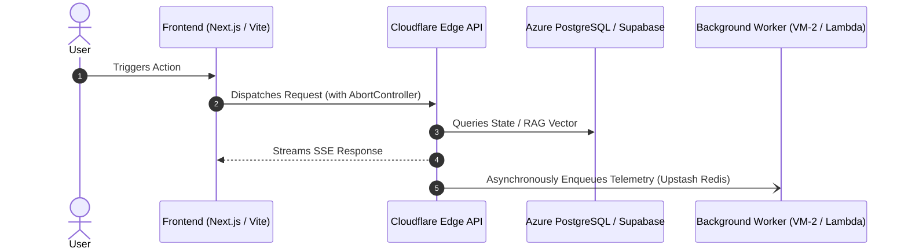

# Production-Grade Architecture Blueprint Template

Use this format when generating the final technical architecture design in Stage 4:

---

```markdown
# 🏛️ TECHNICAL ARCHITECTURE SPECIFICATION: [Feature / Subsystem Name]

## 1. Executive Summary & Problem Statement
- **Problem**: [Clear statement of the friction, missing capability, or latency bottleneck]
- **Target User Value**: [How this transforms user workflow in the author's authentic, humble product tone]
- **Scope & Boundaries**: [What is in-scope vs out-of-scope]

---

## 2. System Topology & Data Flow


---

## 3. Database Schemas & Storage Design
```sql
-- DDL Definitions, Indexes, and Constraints
CREATE TABLE IF NOT EXISTS feature_records (
    id UUID PRIMARY KEY DEFAULT gen_random_uuid(),
    user_id UUID NOT NULL REFERENCES auth.users(id) ON DELETE CASCADE,
    payload JSONB NOT NULL DEFAULT '{}'::jsonb,
    created_at TIMESTAMPTZ NOT NULL DEFAULT NOW(),
    updated_at TIMESTAMPTZ NOT NULL DEFAULT NOW()
);

CREATE INDEX IF NOT EXISTS idx_feature_records_user_id ON feature_records(user_id);
```

---

## 4. API & Edge Route Contracts
```typescript
// Request & Response Types
export interface FeatureRequestPayload {
  sessionId: string;
  query: string;
  contextMode: 'fast' | 'deep' | 'balanced';
}

export interface FeatureStreamChunk {
  type: 'token' | 'card' | 'citation' | 'done';
  data: unknown;
}
```

---

## 5. UI/UX & Mobile Component Architecture
- **Design Tokens**: Dark glassmorphism (`bg-slate-950/70`, `backdrop-blur-2xl`, `border-white/10`).
- **Typography & Tone**: Casual, humble copy (*"hey, this is still being tuned..."*). No corporate marketing buzzwords.
- **Mobile Ergonomics (<= 375px)**:
  * Touch targets $\ge 44\text{px}$.
  * Responsive layout (`w-full max-w-full overflow-x-auto touch-pan-x`).
  * Floating toolbars automatically dock to bottom drawers on mobile viewports.

---

## 6. Itemized Implementation Cards
Ready for execution by the `exhaustive-audit-and-repair` skill:

### [FEAT-01] Core Logic & Data Flow
- **Category**: Backend / API
- **Target Files**: `src/app/api/feature/route.ts`
- **Exact Implementation**: [Specific functions and validation logic]
- **Verification**: `npx tsc --noEmit` & curl test

### [FEAT-02] Frontend UI & Interactive Controls
- **Category**: Frontend Component
- **Target Files**: `src/components/feature/FeaturePanel.tsx`
- **Exact Implementation**: [TipTap node, React Flow node, or responsive card]
- **Verification**: Browser visual test on 360px and 1280px viewports
```
