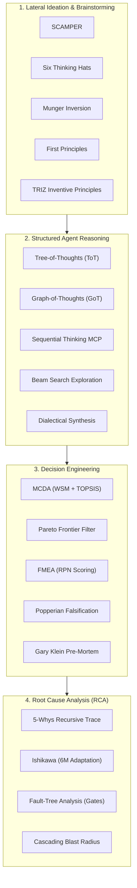

# Cognitive Reasoning Protocols, Brainstorming Frameworks & Decision Systems for Autonomous AI Agents

> **Universal Architecture Specification & Operational Guidelines for Antigravity Cognitive Core**  
> **Integrated into `deep-thinking` Universal Skill**

---

## 1. Executive Summary & Architectural Taxonomy

Autonomous AI agents frequently degrade when forced to reason linearly via simple Chain-of-Thought (CoT). In high-concurrency, multi-tenant, or mission-critical engineering environments, unconstrained agents suffer from hallucination drift, premature convergence, inability to backtrack, and blind spot repetition.

To solve this, the **Antigravity Cognitive Core** integrates four interconnected reasoning pillars:



---

## 2. Pillar I: Brainstorming & Lateral Ideation Frameworks

### 2.1 SCAMPER for System Architecture
SCAMPER forces divergent thinking across seven transformation operators:
- **Substitute**: Replace external dependencies with deterministic zero-cost primitives (e.g., substitute proprietary cloud APIs with edge Cloudflare Workers or local Python scripts).
- **Combine**: Fuse multiple separate passes into atomic operations (e.g., combine schema parsing, validation, and serialization into a single pass).
- **Adapt**: Transpose algorithms from other physical or computer science disciplines (e.g., adopt CPU L1/L2 hardware cache hierarchies for agent episodic memory).
- **Modify / Magnify / Minify**: Stress-test the design across 100x scale variations. What breaks at 10,000 req/s? How does it operate within 16MB RAM?
- **Put to Another Use**: Repurpose existing cold infrastructure (e.g., transform static SQLite session logs into an instant RAG vector cache).
- **Eliminate**: Aggressively strip unnecessary layers, middleware, wrappers, and subagent hops. If a step adds latency without decision entropy, delete it.
- **Reverse / Rearrange**: Invert data flows (e.g., shift from eager push notifications to pull-based client polling; validate data before passing to reasoning layers).

### 2.2 Six Thinking Hats (Edward de Bono)
Autonomous squads adopt six discrete cognitive modes to eliminate groupthink:
1. **White Hat (Empirical Ground-Truth)**: Pure telemetry, benchmark latencies, memory consumption, and verified facts. Zero speculation.
2. **Red Hat (Intuition & Aesthetics)**: Immediate qualitative assessment. Detects architectural bloat, clunky APIs, and "AI slop" without requiring formal proof.
3. **Black Hat (Adversarial Caution & Risk)**: The Devil's Advocate. Surfaces silent failures, race conditions, edge quotas (500MB DB limits), and cascading timeouts.
4. **Yellow Hat (Optimistic Value & Upside)**: Identifies maximal compounding leverage, long-term architectural benefits, and performance breakthroughs.
5. **Green Hat (Radical Lateral Leaps)**: Unconventional, out-of-the-box alternatives that sidestep existing constraints entirely.
6. **Blue Hat (Metacognition & Orchestration)**: Controls the deliberation protocol, tracks thought budgets, enforces arbitration caps, and locks decisions.

### 2.3 Inversion (Charlie Munger / Carl Jacobi)
Instead of asking *"How do we succeed?"*, ask:  
> **"What guarantees catastrophic, irreversible failure?"**

Systematically map the anti-goals:
1. Overwriting or wiping permanent context files in `./`.
2. Spawning defective subagents (`DeepCoder`/`DeepInvestigator`) that fail with missing tool dependencies.
3. Incurring unexpected cloud charges by provisioning public IPv4 addresses on VMs.
4. Exhausting free-tier limits (e.g., writing rich-text ASTs to 500MB Supabase DB).
5. Dumping multi-page raw code blocks into conversation chat.

**The Inversion Shield**: By constructing deterministic technical barriers against every identified anti-goal, success is the inevitable mathematical remainder.

### 2.4 First Principles Decomposition (Aristotle / Feynman / Musk)
Strip all analogical reasoning (*"we should do this because framework X does it"*). Break the problem down to fundamental axioms:
- **Physical/Hardware Limits**: Memory bus bandwidth, disk I/O, speed-of-light networking latency (~5ms per 1,000 km in fiber).
- **Information Theory**: Shannon entropy, minimal state payload size, token consumption vs. decision value.
- **Economic Invariants**: Free-tier quotas, compute cost per token.
Reconstruct the architecture strictly upwards from these axioms, eliminating all legacy dogma.

### 2.5 TRIZ Inventive Principles for AI & Software Systems
Adapt Genrich Altshuller's 40 Inventive Principles to resolve core software contradictions:
- **Speed vs. Consistency** $\to$ **Principle #1 (Segmentation)** & **Principle #10 (Prior Action)**: Decouple synchronous critical paths from background reconciliation; pre-calculate embeddings and warm caches.
- **Autonomy vs. Safety** $\to$ **Principle #2 (Extraction)** & **Principle #23 (Feedback)**: Extract destructive privileges behind deterministic policy gates; enforce closed-loop proof-of-work before completion.
- **Modularity vs. Latency** $\to$ **Principle #7 (Nested Doll)** & **Principle #3 (Local Quality)**: Nest subagents in-process for latency-sensitive tasks; use microservices only at organizational boundaries.
- **Capability vs. Cost** $\to$ **Principle #25 (Self-Service)** & **Principle #13 (Inversion)**: Use zero-cost deterministic scripts for 90% of tasks; route only pre-filtered high-entropy queries to frontier LLMs.

---

## 3. Pillar II: Structured Agent Reasoning

### 3.1 Tree-of-Thoughts (ToT) vs. Graph-of-Thoughts (GoT)
| Characteristic | Tree-of-Thoughts (ToT) | Graph-of-Thoughts (GoT) |
|---|---|---|
| **Topology** | Strict tree hierarchy (Root $\to$ Branches) | Directed Acyclic Graph (DAG) with cycles/feedback |
| **Transformations** | Generate thoughts, Evaluate, Backtrack | Generate, Aggregate (merge branches), Refine in-place |
| **Search Mechanics** | BFS / DFS with pruning | Topological traversal, multi-parent synthesis |
| **Best Suited For** | Linear multi-step deduction, games, math puzzles | Complex systems architecture, trade-off synthesis, multi-source RAG |

### 3.2 Sequential Thinking MCP Pattern
The standard protocol for non-linear agent exploration:
- `thought`: The atomic hypothesis or analytical deduction.
- `thoughtNumber` & `totalThoughts`: Dynamic trajectory sizing that expands or contracts as problem complexity clarifies.
- `isRevision` & `revisesThought`: Self-correction mechanism to invalidate superseded hypotheses without losing lineage.
- `branchFromThought` & `branchId`: Parallel hypothesis exploration before convergence.
- `nextThoughtNeeded: false`: Deterministic stopping condition once falsification passes.

### 3.3 Beam Search in Cognitive Chains
Instead of greedy single-path generation or full combinatorial search:
1. Maintain top-$K$ candidate hypothesis trajectories at depth $d$ (typically $K=3$).
2. Evaluate candidates using a calibrated scoring heuristic $\mathcal{H}(s)$.
3. Prune dominated candidates at each level to maintain a fixed token budget $\mathcal{O}(K \cdot d)$.

### 3.4 Dialectical Thesis-Antithesis-Synthesis
1. **Thesis**: Propose the primary architectural solution $S_1$ with its supporting rationale.
2. **Antithesis**: Formulate the strongest possible counter-proposal $S_2$, attacking $S_1$'s assumptions, failure modes, and cost profile.
3. **Synthesis**: Create an overarching architecture $S_3$ that resolves the contradiction, preserving $S_1$'s benefits while neutralizing $S_2$'s vulnerabilities.

---

## 4. Pillar III: Decision Engineering

### 4.1 Multi-Criteria Decision Analysis (MCDA)
Evaluates $m$ candidate architectures against $n$ weighted criteria $\sum_{j=1}^n w_j = 1$.
- **Weighted Sum Model (WSM)**:
  $$S_i = \sum_{j=1}^n w_j \cdot r_{ij}$$
  where $r_{ij}$ is min-max normalized ($[0, 1]$) based on whether criterion $j$ is a benefit or cost.
- **TOPSIS Algorithm**:
  1. Vector normalize: $n_{ij} = x_{ij} / \sqrt{\sum_k x_{kj}^2}$.
  2. Weight matrix: $v_{ij} = w_j \cdot n_{ij}$.
  3. Determine ideal best $A^+$ and worst $A^-$.
  4. Compute Euclidean distances $d_i^+, d_i^-$.
  5. Calculate relative closeness: $C_i = d_i^- / (d_i^+ + d_i^-) \in [0, 1]$.

### 4.2 Pareto Frontier Filtering
Before scoring, eliminate all **dominated alternatives**:
- Alternative $A$ dominates $B$ if $A \ge B$ on all criteria and $A > B$ on at least one.
- Any alternative outside the Pareto Frontier is mathematically inferior and must be pruned immediately.

### 4.3 Failure Mode and Effects Analysis (FMEA)
Quantifies risk via the Risk Priority Number:
$$\text{RPN} = \text{Severity } (S) \times \text{Occurrence } (O) \times \text{Detection } (D) \quad (S, O, D \in [1, 10])$$
- **Severity ($S$)**: Impact of failure (1 = negligible, 10 = catastrophic system collapse).
- **Occurrence ($O$)**: Likelihood of failure (1 = improbable, 10 = inevitable).
- **Detection ($D$)**: Difficulty of detecting before user impact (1 = caught by compiler/unit test, 10 = silent data corruption).
- **Action Threshold**: $\text{RPN} \ge 200$ or $S \ge 9$ triggers a mandatory, non-negotiable architectural invariant before code is written.

### 4.4 Popperian Falsification Testing
A plan is rejected if it cannot define its own falsification test:
> *"What single empirical test or observation would prove this proposed architecture wrong?"*
Before implementing, write the falsification assertion (e.g., benchmark under 1,000 req/s, schema validation test, network partition simulation).

### 4.5 Gary Klein Pre-Mortem Protocol
Prior to executing high-stakes changes:
1. Fast-forward: Assume the system has completely crashed in production 6 months from now.
2. Independent inquiry: Why did it fail?
3. Generate failure narratives (e.g., certificate expiry, database storage exhaustion, hidden bill shock).
4. Backport preventative controls into today's architecture.

---

## 5. Pillar IV: Root Cause Analysis (RCA)

### 5.1 5-Whys Recursive Drilldown
Avoid superficial stopping points. Drill through five causal depths:
1. **Level 1 (Symptom)**: What failed visibly?
2. **Level 2 (Direct Technical Mechanism)**: What software exception or state caused it?
3. **Level 3 (Architectural Vulnerability)**: What design pattern permitted this state?
4. **Level 4 (Process / Telemetry Gap)**: Why didn't testing or monitoring catch it beforehand?
5. **Level 5 (Systemic Invariant / Governance Root)**: What missing rule or boundary allowed this gap to exist?

### 5.2 Ishikawa (Fishbone) 6M AI Adaptation
Categorize all potential failure contributors across the six adapted dimensions:
1. **Machine / Compute**: Hardware, VM quotas, RAM OOM, GPU memory limits.
2. **Method / Algorithm**: Prompt engineering, search logic, caching algorithms, timeout parameters.
3. **Material / Data**: Context payloads, embedding quality, corrupted schemas, malformed JSON.
4. **Measurement / Telemetry**: Missing logs, misleading health checks, blind spots in metrics.
5. **Milieu / Environment**: Upstream API outages, Cloudflare tunnel disconnects, network jitter.
6. **Man / Agent Governance**: Subagent prompt leaks, improper permissions, missing invariants.

### 5.3 Fault-Tree Analysis (FTA) & Minimal Cut Sets
- Model failures as boolean logic networks:
  - **AND Gates**: All input failures must occur simultaneously for the event to happen (indicates redundancy/defense-in-depth).
  - **OR Gates**: Any single input failure triggers the top event (identifies a **Single Point of Failure / SPOF**).
- Minimal Cut Sets: The smallest combinations of basic events that guarantee system failure. Every single-event cut set under an OR gate is an urgent architectural hazard.

---

## 6. Operational CLI Tool Suite

The `deep-thinking` skill bundles three zero-dependency Python CLI tools in `scripts/`:

### 1. `decision_matrix.py` (MCDA, TOPSIS & FMEA)
```powershell
# Run MCDA analysis on custom JSON or built-in demo
python ./.agents\skills\deep-thinking\scripts\decision_matrix.py score --demo

# Run FMEA failure mode analysis and calculate RPN
python ./.agents\skills\deep-thinking\scripts\decision_matrix.py fmea --demo

# Generate Trilemma Trade-Off Matrix (Latency vs Cost vs Quality)
python ./.agents\skills\deep-thinking\scripts\decision_matrix.py tradeoff
```

### 2. `structured_brainstorm.py` (Lateral Ideation Suite)
```powershell
# SCAMPER ideation prompt generator
python ./.agents\skills\deep-thinking\scripts\structured_brainstorm.py scamper --topic "<system>"

# Six Thinking Hats cognitive decomposition
python ./.agents\skills\deep-thinking\scripts\structured_brainstorm.py sixhats --topic "<decision>"

# Munger Inversion anti-goal analyzer
python ./.agents\skills\deep-thinking\scripts\structured_brainstorm.py inversion --topic "<feature>"

# TRIZ software contradiction matrix resolver
python ./.agents\skills\deep-thinking\scripts\structured_brainstorm.py triz --contradiction autonomy_vs_safety
```

### 3. `rca_drilldown.py` (Root Cause Analysis Engine)
```powershell
# 5-Whys recursive trace
python ./.agents\skills\deep-thinking\scripts\rca_drilldown.py five_whys --demo

# Ishikawa 6M fishbone diagram (Mermaid + Markdown)
python ./.agents\skills\deep-thinking\scripts\rca_drilldown.py ishikawa --demo

# Fault Tree Analysis with boolean gates and cut sets
python ./.agents\skills\deep-thinking\scripts\rca_drilldown.py fault_tree --demo
```
