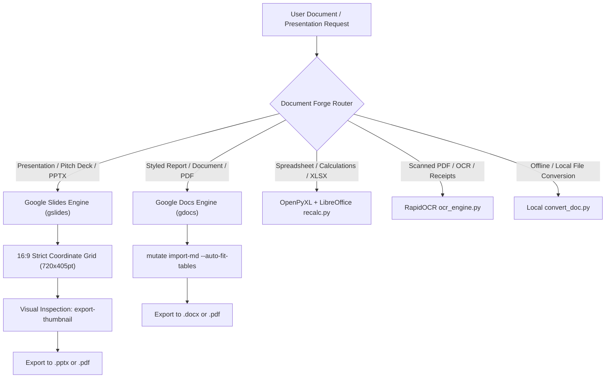

# Document Forge (Universal Document, Presentation & OCR Engine)

> [!IMPORTANT]
> ⛔ **EXECUTION-FIRST MANDATE (ZERO-PASSIVE-READING)**:
> Bundled scripts in `scripts/` and CLI tools (`gslides`, `gdocs`) are **executable software tools**, NOT reading material.
> When this skill is triggered, **EXECUTE the relevant command/script immediately** via `run_command`.
> **STRICT PROHIBITION**: NEVER call `view_file` on scripts in `scripts/` or explain their source code to the user unless explicitly ordered to edit or debug the script itself.
> Universal scripts can and must be executed from **ANY project workspace** by calling their absolute path:
> `python <BRAIN_ROOT>\.agents\skills\document-forge\scripts\<script_name> ...`

> **Unified Multi-Format Processing Suite for Autonomous AI Agents**  
> **Integrates Google Slides (`gslides`), Google Docs (`gdocs`), MarkItDown, PyMuPDF4LLM, RapidOCR (ONNX Runtime), openpyxl, python-docx, and python-pptx**

---

## 1. Architectural Overview & Smart Routing Matrix

`document-forge` acts as the master document and presentation hub. It dynamically selects the optimal engine based on output requirements:



| Output Desired | Primary Engine | Fallback / Local Tool | Why Selected |
|---|---|---|---|
| **Presentation / Slide Deck (`.pptx` / `.pdf`)** | **`gslides`** | `python-pptx` / `soffice.py` | 16:9 mathematical canvas (`720 × 405 pt`), WCAG palettes, visual verification via `export-thumbnail` to prevent text/card overlaps. |
| **Document / Report / Clean PDF (`.docx` / `.pdf`)** | **`gdocs`** | `python-docx` / `docx-js` | Native markdown compilation, `--auto-fit-tables` column balancing, Google cloud typography, zero margin clipping. |
| **Spreadsheets & Data Sheets (`.xlsx`)** | **`openpyxl` + `recalc.py`** | `pandas` | Programmatic formulas, cell styling, headless formula evaluation via LibreOffice. |
| **Scanned Documents & OCR** | **`ocr_engine.py`** | `convert_doc.py` | CPU/ONNX-accelerated RapidOCR without Tesseract dependencies. |
| **Digital PDF Parsing & Form Fill** | **`pymupdf4llm`** | `fill_pdf_form_with_annotations.py` | Sub-second Markdown extraction, interactive form filling. |

---

## 2. Cloud Workspace Engines (`gslides` & `gdocs`)

### A. Google Slides Engine (`gslides`)
When asked to create presentations, pitch decks, slide overviews, or exportable `.pptx` / `.pdf` presentations:
1. **Initialize Presentation**:
   ```bash
   gslides mutate create --title "Presentation Title"
   ```
2. **Apply 16:9 Geometric Coordinates (Never guess layout)**:
   - Canvas: `720 pt` width, `405 pt` height.
   - Safe Margin: `X: 30–690`, `Y: 20–385`.
   - Title: `Y: 15–65`, `width: 660`, `font_size: 36–44`.
   - Cards / Columns: split horizontally with `20pt` gaps (e.g. 2-column: `width: 310` at `x=30` and `x=370`).
3. **Execute in Batches**:
   Use `gslides mutate batch PRES_ID layout.json` for atomic updates.
4. **Visual Proof-of-Work Verification**:
   ```bash
   gslides readonly export-thumbnail PRES_ID slide_preview.png --slide SLIDE_ID
   ```
   Inspect thumbnail to ensure zero text overflow, no clipping, and strong contrast before delivery.
5. **Direct Native Export**:
   ```bash
   gslides readonly export PRES_ID output.pptx --format pptx
   gslides readonly export PRES_ID output.pdf --format pdf
   ```

### B. Google Docs Engine (`gdocs`)
When asked to author clean documentation, research summaries, or print-ready PDFs:
1. **Import Markdown with Auto-Fitting Tables (Paged Mode for Formal Reports)**:
   ```bash
   gdocs mutate import-md "source.md" --title "Report Title" --auto-fit-tables --pageless=false
   ```
2. **Academic / Student Report Anti-Slop Checklist**:
   - Always use **`--pageless=false`** and explicit table column widths for printable academic reports.
   - Keep each diagram/screenshot **paired on the same page** with its caption.
   - Use **short factual figure labels** (`Figure 1: Initial BST`, `Figure 2: Program Output`) — never verbose AI caption sentences.
   - Prefer authentic user assets (hand-drawn diagrams, real IDE screenshots) over generated placeholders, and write in a natural student voice: **strictly forbid** assignment-prompt leakage footers, `"None"` code fence tags, em-dashes, duplicate ASCII trees, and robotic reflection paragraphs.
3. **Export to Native PDF or DOCX**:
   ```bash
   gdocs readonly export DOC_ID "report.pdf" --format pdf
   gdocs readonly export DOC_ID "report.docx" --format docx
   ```

---

## 3. Local Script Command Reference

All scripts reside in `<BRAIN_ROOT>\.agents\skills\document-forge\scripts\`.

### 1. Universal Document to Markdown Conversion
Converts PDF, DOCX, PPTX, XLSX, CSV, or HTML into clean, LLM-ready Markdown:
```powershell
python <BRAIN_ROOT>\.agents\skills\document-forge\scripts\convert_doc.py "path/to/document.pdf" --max-lines 100
# Output directly to file:
python <BRAIN_ROOT>\.agents\skills\document-forge\scripts\convert_doc.py "path/to/presentation.pptx" -o "output.md"
```

### 2. High-Speed Local OCR (Scanned PDFs & Images)
Runs CPU/ONNX-accelerated OCR without external Tesseract binary installations:
```powershell
# OCR an image or screenshot:
python <BRAIN_ROOT>\.agents\skills\document-forge\scripts\ocr_engine.py "receipt.png"

# OCR a scanned PDF:
python <BRAIN_ROOT>\.agents\skills\document-forge\scripts\ocr_engine.py "scanned_doc.pdf" --max-pages 5 -o "extracted.txt"

# Get structured bounding boxes & confidence JSON:
python <BRAIN_ROOT>\.agents\skills\document-forge\scripts\ocr_engine.py "form.png" --json
```

### 3. Spreadsheet (XLSX) Formula Recalculation
LibreOffice computes every formula, updates cached values in place, and returns JSON diagnostics:
```powershell
python <BRAIN_ROOT>\.agents\skills\document-forge\scripts\recalc.py "output.xlsx" 30
```

### 4. Word (DOCX) Comments & Tracked Changes
```powershell
# Add comments directly to a .docx:
python <BRAIN_ROOT>\.agents\skills\document-forge\scripts\comment.py "contract.docx" "Cap is too low" -o "annotated.docx"

# Accept tracked changes:
python <BRAIN_ROOT>\.agents\skills\document-forge\scripts\accept_changes.py "draft.docx" "clean.docx"
```

### 5. PDF Form Filling
```powershell
# Detect fillable fields:
python <BRAIN_ROOT>\.agents\skills\document-forge\scripts\check_fillable_fields.py "form.pdf"

# Fill PDF form with annotations:
python <BRAIN_ROOT>\.agents\skills\document-forge\scripts\fill_pdf_form_with_annotations.py "form.pdf" "fields.json" "filled.pdf"
```

### 6. Production Unified Adapters (Ingest, 16:9 Slides, DOCX Reports, Redlines)
Execute production-grade unified document adapters:
```powershell
# Unified Ingest (auto-detects vector PDF vs OCR vs Office):
python <BRAIN_ROOT>\.agents\skills\document-forge\scripts\doc_adapters.py ingest "sample.pdf"

# Generate 3-Card 16:9 Slide Deck:
python <BRAIN_ROOT>\.agents\skills\document-forge\scripts\doc_adapters.py pptx "deck.pptx" --demo

# Generate Executive DOCX Report with DXA Auto-Fit Table:
python <BRAIN_ROOT>\.agents\skills\document-forge\scripts\doc_adapters.py docx "report.docx" --demo

# Perform Legal Redlining (Tracked Changes):
python <BRAIN_ROOT>\.agents\skills\document-forge\scripts\doc_adapters.py redline "original.docx" "modified.docx"
```

### 7. Frontier Multimodal Document Understanding (Argon 2M Window)
When documents contain complex multi-column scientific layouts, dense tabular financial ledgers, or low-resolution scans where local OCR produces artifacts, leverage Gemini 4 Argon's native multimodal understanding via programmatic CDP upload:
```powershell
python <BRAIN_ROOT>\.agents\skills\deep-thinking\scripts\consult_argon.py \
  "Transcribe, structure, and extract all mathematical formulas, tables, and sections into clean Markdown." \
  --profile "Profile 13" \
  -f "complex_report.pdf" \
  -o "temp_read/transcribed_report.md"
```

---

## 4. Best Practices & Verification Guidelines

1. **Zero Guesswork Layouts**: Always follow the 16:9 safe margin zones (`30–690` X, `20–385` Y for Google Slides, $0.80" - 12.53"$ for PPTX).
2. **Contrast Standard**: Always enforce WCAG $\ge 4.5:1$ contrast ratio. Never pair dark text on dark backgrounds.
3. **Table Column Balancing**: Always enforce DXA column sums ($9,360\text{ dxa}$) in DOCX and pass `--auto-fit-tables` on `gdocs` imports to prevent horizontal wrapping breaks.
4. **Visual Loop**: Whenever creating or editing slides, generate a thumbnail image with `export-thumbnail` and inspect it before delivering to the user.

---

## 5. Architectural Reference Guides

Detailed specialized engineering guides located in `references/`:
- **[Presentation Design & 16:9 Geometry](references/guidelines_presentation_design.md)**: Anthropic PPTX invariants, hex colors without `#`, 3-5-7 anti-crowding rule, card container architecture.
- **[Report & DOCX Engineering](references/guidelines_report_and_docx.md)**: DXA mathematical table budgeting, OOXML `w:tblHeader` & `w:cantSplit`, modular typographic scales, tracked changes.
- **[Modern OCR & Document Understanding Engines](references/guidelines_ocr_engines.md)**: Complete benchmark of Docling, Marker, Surya, Nougat, RapidOCR, Tesseract, and PyMuPDF4LLM.
- **[Comprehensive Document Engineering Guide](references/document_engineering_and_ocr_guide.md)**: Full architectural briefing on ingestion, synthesis, and model tradeoffs.
