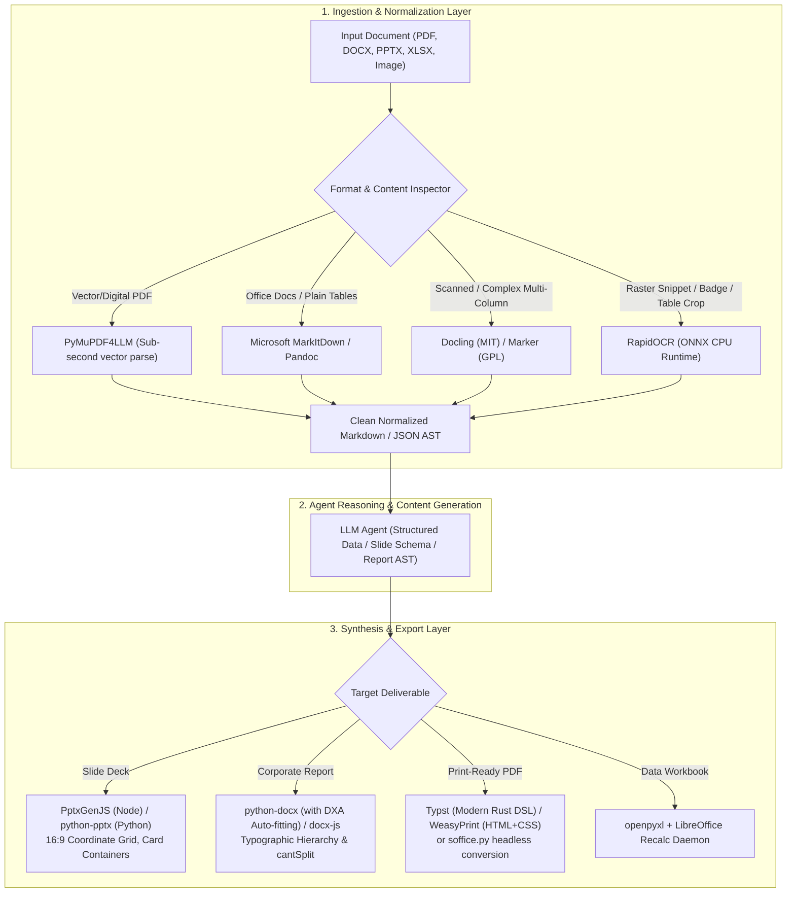

# Technical Briefing: Document Engineering & OCR Engines for Autonomous AI Agents

**Audience**: AI Agent Architects & Autonomous System Engineers  
**Scope**: Ingestion, programmatic generation, typographic design rules, PPTX 16:9 layout geometry, and benchmark comparison of 7 open-source OCR/document-understanding engines.

---

## 1. Unified Document Engineering Architecture

Autonomous agents require a bidirectional document pipeline: **Ingestion (Parse/Normalize to LLM AST)** and **Synthesis (Programmatic Authoring to Office/PDF formats)**.



### Core Design Principles for Agent Document Engineering
1. **Never Parse Office Files with Regex or Pure Text Extraction**:
   Word documents (`.docx`), presentations (`.pptx`), and spreadsheets (`.xlsx`) are ZIP archives containing interrelated Open Packaging Conventions (OPC) XML files. Parsing them as raw strings destroys tables, slide boundaries, cell formulas, and hierarchical headers.
2. **Strict Ingestion Routing**:
   - Check if a PDF contains native vector text first. Running heavy vision-language OCR models (Nougat/Docling) on clean vector PDFs wastes GPU/CPU cycles and introduces OCR hallucination risk.
   - Use `pymupdf4llm` as Tier-0 for digital PDFs. Fall back to `Docling` or `RapidOCR` only when text density is zero (scanned raster).
3. **Lossless Headless Conversions**:
   - Use headless LibreOffice (`soffice --headless --convert-to pdf document.docx`) via an isolated subprocess wrapper with timeout protection to prevent zombie daemon hangs.

---

## 2. PPTX & Presentation Design Systems for Agents

Autonomous agents frequently fail at presentation design by creating **"walls of bulleted text"**, miscalculating 16:9 coordinate bounds, overlapping text containers, and improperly configuring charts.

### A. 16:9 Canvas Geometry & Coordinate System
Modern presentation software targets **16:9 widescreen**. Agents must calculate absolute coordinates using a strict coordinate system:

| Engine | Canonical Dimensions | Unit | Safe Margin X | Safe Margin Y | Content Width |
|---|---|---|---|---|---|
| **python-pptx** | $13.333\text{ in} \times 7.500\text{ in}$ | `Inches` / `Pt` | $0.80\text{ in}$ to $12.53\text{ in}$ | $0.60\text{ in}$ to $6.90\text{ in}$ | $11.733\text{ in}$ |
| **PptxGenJS** (`LAYOUT_16x9`) | $10.0\text{ in} \times 5.625\text{ in}$ | `Inches` | $0.60\text{ in}$ to $9.40\text{ in}$ | $0.45\text{ in}$ to $5.17\text{ in}$ | $8.80\text{ in}$ |
| **Google Slides / Web Canvas** | $720\text{ pt} \times 405\text{ pt}$ | `Points` | $30\text{ pt}$ to $690\text{ pt}$ | $20\text{ pt}$ to $385\text{ pt}$ | $660\text{ pt}$ |

### B. Vertical Rhythm & Layout Grid Blueprint (13.333" x 7.5" Canvas)
```
+---------------------------------------------------------------------------------------+
|  Top Margin (0.60")                                                                   |
|  +---------------------------------------------------------------------------------+  |
|  | CATEGORY KICKER (11pt Bold Uppercase, Accent Color)                             |  |
|  | Action-Oriented Takeaway Headline (28-32pt Bold, Dark Slate)                   |  |
|  | Subtitle / Contextual Anchor (14pt Regular, Neutral Muted)                     |  |
|  +---------------------------------------------------------------------------------+  |
|  Header-to-Body Gap (0.40")                                                           |
|  +-----------------------+ +-----------------------+ +-----------------------+        |
|  | Card 1 (Width: 3.64")  | | Card 2 (Width: 3.64")  | | Card 3 (Width: 3.64")  |        |
|  | [Rounded Rect Container]| [Rounded Rect Container]| [Rounded Rect Container]|        |
|  | Metric: 48pt Bold     | | Metric: 48pt Bold     | | Metric: 48pt Bold     |        |
|  | Label: 12pt Uppercase | | Label: 12pt Uppercase | | Label: 12pt Uppercase |        |
|  | Body: 12-14pt Bullet  | | Body: 12-14pt Bullet  | | Body: 12-14pt Bullet  |        |
|  +-----------------------+ +-----------------------+ +-----------------------+        |
|  Bottom Safe Area (0.60")                                                             |
+---------------------------------------------------------------------------------------+
```

### C. Anti-Slop Visual Hierarchy Rules
1. **Action-Oriented Headlines**:
   - ❌ *Slop*: "Cloud Migration Overview", "Q3 Performance", "Architecture Details"
   - ✅ *Action*: "AWS Migration Cut Infrastructure Costs by 34% in Q3", "Zero-Trust Architecture Prevents Lateral Movement"
2. **Chunking & Container Cards**:
   - Never place floating text on a blank background.
   - Group data into 2, 3, or 4 distinct cards (`ROUNDED_RECTANGLE`) with a subtle fill (e.g. `#F8FAFC` or `#0F172A`) and a 1pt neutral border (`#E2E8F0` or `#1E293B`).
3. **The 3-5-7 Anti-Crowding Rule**:
   - Maximum 3 to 5 cards/points per slide.
   - Maximum 7 lines of body text per card.
   - Bold the first 2–4 words of every bullet point for instant scannability.
4. **Hero Metric Callouts**:
   - Key findings must feature large statistical typography: **44–56pt bold numbers**, followed by a **10–12pt uppercase descriptive label**.
5. **Anthropic / Claude Code PPTX Footguns & Invariants**:
   - **Color Format**: Hex strings must **never contain `#`** in `PptxGenJS` (e.g. `color: "1E293B"`, NOT `"#1E293B"`; `#` corrupts the XML).
   - **Option Mutation**: `PptxGenJS` mutates option objects in place (converting properties to EMUs). Never reuse options dictionaries across multiple shapes.
   - **Shadow Offsets**: Offsets must be $\ge 0$. Negative values corrupt the file.
   - **Native Chart Combo Crash**: Any combo chart utilizing secondary axes must explicitly declare **both** `valAxes` and `catAxes` (two entries each). Failing to declare category axes causes PowerPoint to reject the file as corrupted.

---

## 3. DOCX & PDF Report Design Systems

High-stakes executive reports, whitepapers, and legal redlines require rigorous typographic metrics and robust table handling.

### A. Typographic Rhythm & Vertical Metrics
1. **Modular Scale (Major Third 1.25)**:
   - Document Title: $26\text{ pt}$ Bold, Line Spacing $1.15\times$, Space After $12\text{ pt}$.
   - Heading 1: $18\text{ pt}$ Bold, Space Before $16\text{ pt}$, Space After $6\text{ pt}$, `keep_with_next = True`.
   - Heading 2: $14\text{ pt}$ Semi-Bold, Space Before $12\text{ pt}$, Space After $4\text{ pt}$, `keep_with_next = True`.
   - Body Paragraph: $10.5\text{ pt}$ Regular, Line Spacing $1.25\times$, Space After $6\text{ pt}$, Space Before $0\text{ pt}$.
2. **Zero Empty Paragraphs**:
   - Never insert `\n\n` or blank paragraph tags to create vertical whitespace. Always enforce spacing through `paragraph_format.space_after` and `space_before`.
3. **Widow/Orphan & Page Break Guardrails**:
   - Always set `keep_with_next = True` on all heading styles to eliminate orphaned headers at page bottoms.
   - Enforce `widow_control = True` on body paragraphs.

### B. Table Auto-Fitting & OOXML XML Manipulation
By default, `python-docx` creates unstable tables that clip beyond page boundaries when viewed in Word or LibreOffice.

- **DXA Unit System**: In OpenXML, dimensions are measured in **DXA** (twips; 1/20 of a point; $1440\text{ dxa} = 1\text{ inch}$).
- **Calculated Table Geometry**:
  $$\text{Page Width (8.5")} = 12,240\text{ dxa}$$
  $$\text{Margins (1.0" Left + 1.0" Right)} = 2,880\text{ dxa}$$
  $$\text{Printable Column Budget} = 9,360\text{ dxa}$$
- **Three Essential OOXML Table Invariants**:
  1. `w:tblHeader`: Repeats the header row automatically if a table splits across pages.
  2. `w:cantSplit`: Prevents individual rows from breaking in half across page boundaries.
  3. Explicit `w:gridCol` and `w:tcW`: Every column and cell must have an explicit width in `dxa` that sums up exactly to the total table budget.

### C. Tracked Changes (Redlining) & Programmatic Comments
When agents review contracts or drafts:
- Insertions are marked via OpenXML `<w:ins w:id="1" w:author="AI Reviewer" w:date="2026-10-07T12:00:00Z"><w:r><w:t>new text</w:t></w:r></w:ins>`.
- Deletions are marked via `<w:del w:id="2" w:author="AI Reviewer" w:date="2026-10-07T12:00:00Z"><w:r><w:delText>old text</w:delText></w:r></w:del>`.
- Highlighting and margins comments require injecting `<w:commentRangeStart>`, `<w:commentRangeEnd>`, and `<w:commentReference>` pointing to `word/comments.xml`.

---

## 4. Modern Open-Source OCR & Document Understanding Benchmark

Comprehensive evaluation of the leading 7 engines for document ingestion and text extraction:

| Engine | Primary Architecture | Output Format | Hardware / Footprint | Speed / Throughput | License | Key Strengths | Critical Weaknesses / Failure Modes |
|---|---|---|---|---|---|---|---|
| **Docling** *(IBM Research)* | DocLayNet + TableFormer + EasyOCR/RapidOCR/Tesseract hybrid pipeline | Clean Markdown, JSON AST, DoclingDocument, HTML | **CPU & GPU**<br/>Min: 4GB RAM (CPU mode)<br/>Opt: 8GB VRAM (CUDA/MPS) | CPU: ~1.5–4.0 s/pg<br/>GPU: ~0.4–0.9 s/pg | **MIT** *(Permissive Enterprise)* | • Native multi-format (PDF, DOCX, PPTX, XLSX, HTML)<br/>• Best-in-class table AST & cell bounding boxes<br/>• Full hierarchical chunking for RAG | High memory spike on 200+ page scans if not batched. |
| **Marker** *(Datalab)* | Surya Layout + Texify (ViT/Transformer) + LLM cleanup pass | Markdown with LaTeX math, clean tables | **GPU Preferred**<br/>Min: 8GB VRAM<br/>Opt: 16GB VRAM (H100/A100) | GPU: ~15–120 pgs/sec<br/>CPU: Very slow (~8–15 s/pg) | **GPL-3.0** + Commercial RAIL restriction | • Ultra-high fidelity on academic equations & formulas<br/>• Rapid batch throughput on GPU servers | Restrictive license for commercial SaaS; CPU performance poor. |
| **Surya** *(Datalab)* | SegFormer + ViT layout detector, text detection & reading order models | Line bboxes, text strings, layout polygons, reading order | **GPU Preferred**<br/>(CPU viable with PyTorch) | GPU: ~0.2–0.5 s/pg<br/>CPU: ~2.5–5.0 s/pg | **GPL-3.0** | • 90+ languages supported out of the box<br/>• Exceptional line-level polygon detection & table grids | Standalone engine requires assembly pipeline to output unified Markdown. |
| **Nougat** *(Meta AI)* | Donut (Vision Transformer encoder + mBART decoder autoregression) | Academic Markdown with LaTeX formulas | **GPU Mandatory**<br/>Min: 12GB VRAM<br/>Opt: 24GB VRAM (A10G) | GPU: ~2.0–5.0 s/pg<br/>CPU: Unusable (>30 s/pg) | **CC-BY-NC-4.0** *(Non-Commercial)* | • Direct image-to-LaTeX sequence generation<br/>• Handles dense mathematical physics/math papers | • High hallucination rate on non-academic layouts<br/>• Loops/repeats tokens on blank or noisy pages. |
| **RapidOCR** *(RapidAI)* | PP-OCRv4 (DBNet detection + SVTR recognition) via **ONNX Runtime** | Bounding boxes, text string, confidence scores | **Ultra-Light CPU**<br/>Zero PyTorch/CUDA required (~150MB footprint) | CPU: **15–50 ms/crop**<br/>~150–400 ms/full page | **Apache 2.0** *(Permissive)* | • Sub-second CPU execution on standard VMs<br/>• Zero native compilation or heavyweight dependencies | Lacks global document reading order & multi-column layout comprehension. |
| **Tesseract** *(Google / HP)* | Traditional image binarization + LSTM line recognition | Plain text, HOCR, PDF searchable layer | **CPU Only**<br/>Requires native binary installed | CPU: ~1.0–3.0 s/pg | **Apache 2.0** | • 100+ language traineddata available<br/>• Universal presence across Linux distributions | • Fails on complex tables, multi-column flows, and formulas<br/>• Severe accuracy loss on low-res or warped scans. |
| **PyMuPDF4LLM** *(Artifex)* | Direct Poppler/MuPDF C-engine vector text extraction & layout heuristics | High-quality Markdown with GitHub tables | **Ultra-Light CPU**<br/>Instantaneous (~20MB memory) | CPU: **10–40 ms/page**<br/>(1,000+ pgs/min) | **AGPL-3.0** / Commercial Artifex | • Blazing fast vector extraction for digital PDFs<br/>• Retains links, font weights, and table formatting | **Zero OCR capabilities** — completely blank on scanned images without text layer. |

---

## 5. Architectural Decision Matrix for Autonomous Agents

| Ingestion Scenario | Primary Choice | Fallback Choice | Rationale |
|---|---|---|---|
| **Native Digital PDF (Text Layer Exists)** | **`pymupdf4llm`** | `markitdown` | Instantaneous CPU extraction (sub-50ms), zero vision model hallucinations, perfect table boundaries. |
| **Scanned Documents & Receipts (CPU-only VM)** | **`rapidocr_onnxruntime`** | `docling` (CPU mode) | Lightweight ONNX execution without loading gigabyte PyTorch weights; zero C++ system dependencies. |
| **Enterprise Multi-Format Docs (PDF, DOCX, PPTX)** | **`docling`** | `pymupdf4llm` + `python-docx` | Permissive MIT license, unifies all formats under a single `DoclingDocument` AST with cell-level table tracking. |
| **Dense Academic Papers / Complex Math Formulas (GPU)** | **`marker-pdf`** | `nougat` | Exceptional LaTeX formula and inline symbol parsing with high GPU throughput. |
| **Receipt / Identity Card / Cropped Region Text** | **`rapidocr_onnxruntime`** | `surya` | Millisecond inference on cropped bounding boxes. |

---

## 6. Installation & Execution Reference

### 1. Docling (IBM)
```bash
# Installation (Python 3.10+)
pip install docling

# CLI Command
docling "path/to/annual_report.pdf" --to md --to json --output ./extracted/

# Python Snippet
from docling.document_converter import DocumentConverter

converter = DocumentConverter()
result = converter.convert("path/to/document.pdf")
markdown_text = result.document.export_to_markdown()
```

### 2. Marker (Datalab)
```bash
# Installation
pip install "marker-pdf[full]"

# CLI Command (Single PDF)
marker_single input.pdf --output_dir ./marker_out --output_format markdown

# CLI Command (Batch with parallel GPU workers)
marker /path/to/pdf_folder/ ./batch_out/ --workers 4 --use_llm

# Python Snippet
from marker.converters.pdf import PdfConverter
from marker.models import create_model_dict

models = create_model_dict()
converter = PdfConverter(artifact_dict=models)
rendered = converter("paper.pdf")
print(rendered.markdown)
```

### 3. Surya OCR (Datalab)
```bash
# Installation
pip install surya-ocr

# CLI Commands
surya_ocr input.pdf --langs en --output_dir ./surya_results
surya_layout input.pdf --output_dir ./surya_layout
surya_table input.pdf --output_dir ./surya_tables
```

### 4. RapidOCR (ONNX Runtime)
```bash
# Installation (Zero PyTorch needed)
pip install rapidocr_onnxruntime

# CLI Command
rapidocr -img receipt.png

# Python Snippet
from rapidocr_onnxruntime import RapidOCR

engine = RapidOCR()
result, elapse = engine("receipt.png")
# result structure: [[ [x1,y1], [x2,y2], [x3,y3], [x4,y4] ], "Detected Text", confidence_float]
for item in result or []:
    bbox, text, score = item
    print(f"[{score:.2f}] {text}")
```

### 5. PyMuPDF4LLM
```bash
# Installation
pip install pymupdf4llm

# CLI Command
pymupdf4llm -o document.md input.pdf

# Python Snippet
import pymupdf4llm

# Single markdown string
markdown_output = pymupdf4llm.to_markdown("whitepaper.pdf")

# Page-chunked extraction for RAG indexing
chunks = pymupdf4llm.to_markdown("whitepaper.pdf", page_chunks=True)
for chunk in chunks:
    page_num = chunk["metadata"]["page"]
    content = chunk["text"]
```

---

## 7. Python Production Adapters

For ready-to-use production adapters implementing the unified router, PPTX 16:9 layout engine, DOCX auto-fit table builder, and tracked changes engine, inspect:
`file:///./temp_read/doc_adapters.py`
