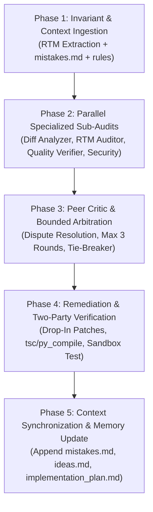

# Universal Multi-Agent Code Audit & Architectural Repair System (UMACAR)

UMACAR is a battle-tested, production-grade multi-agent audit and repair engine. It coordinates specialized subagent squads to perform deep repository audits, trace user requirements from project context files into actual code symbols, scan diffs against historical failure ledgers (`mistakes.md`), enforce live compiler/runtime verification, and autonomously deliver verified drop-in repairs.

---

## 1. When to Activate This Skill

Activate this skill autonomously whenever:
- The user requests a **code review**, **code audit**, **deep bug investigation**, or **system overhaul** (e.g. *"audit this project"*, *"review my changes"*, *"fix broken features"*, *"why is this failing"*).
- The user asks to verify if all their requirements or past decisions have been implemented.
- The user invokes `/teamwork-preview`, `/boost`, `/goal`, or `/exhaustive-audit-and-repair`.
- You are resolving regressions, auditing database/storage quotas (Supabase 500MB DB limits, Cloudflare R2), or ensuring past bugs from `mistakes.md` are not reintroduced.

---

## 2. The 5-Phase Multi-Agent Audit & Repair Workflow



---

## 3. The Multi-Agent Squad Roles & Delegation Rules

When operating in delegation mode, the Lead Orchestrator delegates tasks to specialized subagents.

> [!IMPORTANT]
> **Subagent Runtime Invariant**: NEVER spawn subagents with `TypeName='DeepCoder'` or `TypeName='DeepInvestigator'` (they crash in 1s due to Antigravity's missing `skill_search` component), and NEVER pass `Model='flash'`. ALWAYS spawn subagents using `TypeName='self'` for coding/auditing/reasoning, `TypeName='research'` for read-only exploration, and `Model='inherit'`. Because subagents strip parent `<skills>` XML, inject exact skill paths and CLI commands into every subagent `Prompt`. For interactive live browser execution, NEVER invoke 4-tier `/teamwork` planning theater — use a direct runner + lightweight sentinel.

| Squad Role | Subagent Type | Key Responsibilities & Invariants |
|---|---|---|
| **Lead Orchestrator** | `self` (Parent/Lead) | Decomposes scope, triggers CLI runner, assigns file clusters, arbitrates disputes, synthesizes master report. |
| **Requirement Traceability Auditor (RTM)** | `self` | Compares user prompt, `ideas.md`, `requirements.md`, and `active_context.md` against codebase AST. Flags unimplemented or half-implemented features. |
| **Static & Quality Verifier** | `self` | Runs live compilers (`npx tsc --noEmit`, Python `ast.parse` / `py_compile`), linters, mobile touch targets ($\ge 44\text{px}$), and viewport overflow ($\le 375\text{px}$). |
| **Security & Anti-Regression Auditor** | `self` | Scans diff hunks against Central Brain's forensic ledger ([`mistakes.md`](file:///<BRAIN_ROOT>/mistakes.md)) and OWASP rules to prevent recurring bugs. |
| **Remediation & Patch Engineer** | `self` | Generates surgical, drop-in replacement patches. **Prohibited from self-certifying work.** Must pass independent verification. |
| **Peer Critic** | `self` / `research` | Actively challenges findings for false positives. Engages in bounded 3-round debate before consensus. |

---

## 4. Running the Audit Orchestrator CLI Tool

The skill includes a standalone, zero-token Python engine located at:
`brain/.agents/skills/exhaustive-audit-and-repair/scripts/audit_orchestrator.py`

### CLI Commands & Execution Examples

```powershell
# 1. Full Audit of Active Workspace (including RTM, Quality, Mobile, and Mistakes)
python .agents/skills/exhaustive-audit-and-repair/scripts/audit_orchestrator.py --project .

# 2. Audit a Specific Project from Central Brain
python .agents/skills/exhaustive-audit-and-repair/scripts/audit_orchestrator.py --project "<USER_HOME>\Desktop\project-web"

# 3. Audit Git Diff of Recent Changes
python .agents/skills/exhaustive-audit-and-repair/scripts/audit_orchestrator.py --project . --diff git

# 4. Generate Only the Requirement Traceability Matrix (RTM)
python .agents/skills/exhaustive-audit-and-repair/scripts/audit_orchestrator.py --project . --rtm-only

# 5. Output Markdown Report to a Specific File in temp_read/
python .agents/skills/exhaustive-audit-and-repair/scripts/audit_orchestrator.py --project . --output temp_read/audit_report.md
```

---

## 5. Requirement Traceability Matrix (RTM) Protocol

To ensure that **every single user request** and architectural commitment in `ideas.md` is actually implemented (and not just claimed to be implemented):

1. **Extraction**: The RTM engine parses project context files:
   - `context/ideas.md` & `ideas.md`
   - `context/requirements.md` & `requirements.md`
   - `context/todo.md` & `todo.md`
   - Recent user prompt instructions
2. **AST Symbol Matching**:
   - Indexes all functions, classes, interfaces, and routes across Python and TypeScript.
   - Matches requirement keywords to code symbols.
3. **Status Classification**:
   - `IMPLEMENTED`: Symbol exists AND has active test/runtime coverage.
   - `PARTIAL`: Symbol exists but lacks tests, contains `TODO`, or returns dummy mocks.
   - `UNIMPLEMENTED`: Present in specifications, but zero matching symbols exist in code.
   - `ORPHANED`: Code exists without any specification or user request.
4. **Zero-Mock Policy Enforcement**:
   - Any feature returning fake placeholder objects (e.g. `mock_user`, `dummy_profile`) is flagged as `HIGH` severity violation.

---

## 6. Anti-Regression Scanning & Forensic Memory Feedback Loop

### Scanning Against `mistakes.md`
Before approving any code change or PR:
1. Ingest all 20+ universal system invariants from `mistakes.md` (e.g. No `DeepCoder` invocation, No Central Brain overwrites, Zero Public IPv4 addresses, 25s Cloudflare Worker timeouts, Ephemeral GPU zero-waste).
2. Dynamically scan incoming diff hunks against regex patterns.
3. Any violation immediately flags a `CRITICAL` or `HIGH` blocking finding.

### Automatic Memory Synchronization
When a new defect, regression, or root cause is repaired:
1. **Append to `context/mistakes.md` & `brain/mistakes.md`**:
   ```markdown
   ### Auto-Logged Audit Remediation: <Title>
   * **Date**: YYYY-MM-DD
   * **File Affected**: `<file_path>` (Lines <start>-<end>)
   * **Mistake**: <Description of failure>
   * **Root Cause**: <Underlying architectural mechanism>
   * **Invariant**: <Mandatory guardrail rule>
   ```
2. **Append to `context/ideas.md` & `brain/ideas.md`**:
   Log newly finalized architectural patterns as standardized chronological bullets:
   `- **YYYY-MM-DD (<Feature Title>)**: <Decision notes & rationale>`
3. **Update `implementation_plan.md`**:
   Replace `[PENDING EXECUTION]` placeholders with verified resolution summaries.

---

## 7. Two-Party Verification & Proof-of-Work Standard

Never claim an issue is resolved without live proof:
1. **TypeScript / Next.js Projects**: Run `npx tsc --noEmit` — must exit with **0 errors**.
2. **Python Projects**: Run `python -m py_compile <modified_file>` or AST parse test.
3. **Mobile Ergonomics**: Inspect JSX/HTML for `min-h-[44px]` touch targets and ensure no fixed widths break viewports $\le 375\text{px}$.
4. **Two-Party Verification**: The agent writing the fix cannot verify it; a separate verifier pass must validate the patch before signoff.
5. **Anti-Masking Assertion Rule**: Test harnesses and health checks must NEVER catch HTTP `4xx`/`403`/`5xx` upstream errors and still print `[OK]` or mark models healthy (e.g., `gemini-4-carbon` `403` policy rejections must surface explicitly as `policy_blocked` / `unavailable`).

---

## 8. Selector Drift Self-Healing & Visual Verification Loop

When dynamic SPAs (such as `gemini.google.com`, `/usage`, or AI Studio) update their DOM hierarchy, causing `browser-operator` selector misses:
1. **Visual Snapshot Capture**: Immediately trigger `Page.captureScreenshot` to `temp_read/error_snapshot.png`.
2. **Visual Inspection**: Audit the rendered layout using `view_file` to identify mutated element classes, coordinates, or overlay backdrops.
3. **Dynamic Self-Healing**: Patch `gemini_brain_driver.py` or `stealth_input.py` using ARIA role selectors, text-matching regex (`findByText`), or coordinate-based dispatch rather than brittle CSS paths.
4. **Automated Verification**: Re-run the navigation or click sequence and verify live completion before resuming parent task execution.
