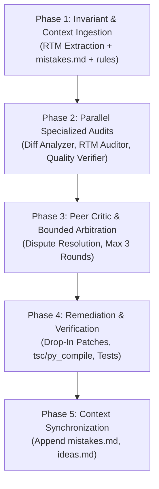

# Universal Multi-Agent Code Audit & Architectural Repair (UMACAR)

> **Step-0 Project Overlay**: Before executing, check if `<active-project>/.agents/skill_overlays/exhaustive-audit-and-repair.md` exists (via `python .agents/skills/auto-skill/scripts/resolve_skill_overlay.py --project <root> --skill exhaustive-audit-and-repair`).

> [!IMPORTANT]
> ⛔ **EXECUTION-FIRST MANDATE**: Scripts in `scripts/` are executable software tools, NOT documentation. Never ask the user to run them or read them passively. Execute immediately via shell commands. When invoking Windows binaries from WSL, append `< /dev/null`.

---

## 1. When to Activate UMACAR

Activate autonomously whenever:
- User requests a **code review**, **code audit**, **deep bug investigation**, or **system overhaul**.
- Verifying whether user requirements from `ideas.md` and `active_context.md` are fully implemented in actual code symbols.
- Preventing regressions against Central Brain's forensic failure ledger (`mistakes.md`).
- Auditing database/storage quotas (Supabase 500MB DB limit, Cloudflare R2 egress rules).

---

## 2. The 5-Phase Audit & Repair Workflow



---

## 3. Delegation Roles & Runtime Invariants

- **Subagent Runtime Invariant**: NEVER spawn subagents with `TypeName='DeepCoder'` or `TypeName='DeepInvestigator'` (they crash on missing `skill_search`). ALWAYS use `TypeName='self'` for implementation and `TypeName='research'` for read-only exploration (`Model='inherit'`).
- **Two-Party Rule**: Patch engineers are strictly forbidden from self-certifying repairs. An independent verifier must confirm compiler/type/test passes.
- **Mobile Ergonomics**: Enforce touch targets $\ge 44	ext{px}$ and zero horizontal viewport overflow at widths $\le 375	ext{px}$.

---

## 4. Core CLI Commands

```bash
# 1. Run automated code audit on active project
python .agents/skills/exhaustive-audit-and-repair/scripts/audit_orchestrator.py --project "<active_project>"

# 2. Extract requirement traceability matrix (RTM)
python .agents/skills/exhaustive-audit-and-repair/scripts/audit_orchestrator.py --project "<active_project>" --mode rtm

# 3. Scan diffs against historical mistakes ledger
python .agents/skills/exhaustive-audit-and-repair/scripts/audit_orchestrator.py --project "<active_project>" --scan-mistakes
```

---

## 5. References & Audit Patterns

- [Deep Audit Playbook & RTM Protocol](references/audit_playbook.md) — Comprehensive guide to RTM mapping and dispute arbitration.
- [Open Source Review Patterns](references/open_source_review_patterns.md) — Proven architectural review checklists and anti-patterns.
- [Message Schemas](references/message_schemas.md) — Communication contracts for multi-agent audit squads.