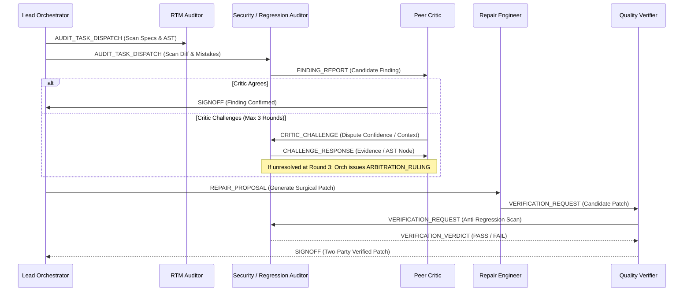

# Universal Multi-Agent Code Audit & Repair Message Schemas

> **Protocol Version**: `1.0.0`  
> **Schema Standard**: Standardized JSON envelopes for inter-agent communication, peer critic debates, and independent two-party verification.

---

## 1. Core Message Envelope Specification

Every message exchanged between audit squad agents (`ORCHESTRATOR`, `RTM_AUDITOR`, `QUALITY_AUDITOR`, `REGRESSION_AUDITOR`, `REPAIR_ENGINEER`, `CRITIC`) must adhere to this JSON structure:

```json
{
  "$schema": "https://json-schema.org/draft/2020-12/schema",
  "envelope_id": "msg_20261017120000123456",
  "timestamp": "2026-10-17T10:41:34.515483Z",
  "conversation_id": "audit_20261017_104134",
  "correlation_id": "FIND-REG-001-DEFECTIVE-SUBAGENT",
  "sender_role": "REGRESSION_AUDITOR",
  "recipient_role": "CRITIC",
  "message_type": "FINDING_REPORT",
  "iteration_round": 1,
  "payload": {
    "finding_id": "FIND-REG-001-DEFECTIVE-SUBAGENT",
    "category": "REGRESSION_MISTAKE",
    "severity": "CRITICAL",
    "title": "Defective DeepCoder/DeepInvestigator Invocation Detected",
    "description": "Found TypeName='DeepCoder' in service_worker.py which triggers 1s executor construction crash.",
    "file_path": "services/service_worker.py",
    "line_start": 42,
    "line_end": 42,
    "rule_id": "REG-001-DEFECTIVE-SUBAGENT",
    "suggested_fix": "Replace TypeName='DeepCoder' with TypeName='self'.",
    "confidence": 0.95,
    "status": "OPEN"
  }
}
```

---

## 2. Message Types & Communication Flows



---

## 3. Message Type Definitions

| Message Type | Sender | Recipient | Payload Purpose |
|---|---|---|---|
| `AUDIT_TASK_DISPATCH` | `ORCHESTRATOR` | Any Auditor | Specifies audit scope, target files, diff hunks, and context references. |
| `FINDING_REPORT` | Auditor | `CRITIC` / `ORCHESTRATOR` | Reports an identified defect, regression, requirement gap, or quality violation. |
| `CRITIC_CHALLENGE` | `CRITIC` | Auditor | Challenges a finding as a potential false positive or cites conflicting context. |
| `CHALLENGE_RESPONSE` | Auditor | `CRITIC` | Provides corroborating code snippets, AST symbols, or accepts downgrade. |
| `ARBITRATION_RULING` | `ORCHESTRATOR` | All Agents | Deterministic tie-breaking decision after 3 rounds of deliberation. |
| `REPAIR_PROPOSAL` | `REPAIR_ENGINEER` | `QUALITY_AUDITOR` | Contains proposed drop-in replacement diff (no premature application). |
| `VERIFICATION_REQUEST` | `REPAIR_ENGINEER` | `QUALITY_AUDITOR` | Requests live compiler / linter / test check of tentative patch. |
| `VERIFICATION_VERDICT` | `QUALITY_AUDITOR` | `ORCHESTRATOR` | `PASS` or `FAIL` with compiler stdout/stderr logs. |
| `SIGNOFF` | Any Agent | `ORCHESTRATOR` | Final confirmation of verified resolution or item closure. |

---

## 4. Bounded Arbitration Rules (Loop Prevention)

1. **Max 3 Deliberation Rounds**:
   - Round 1: Initial `FINDING_REPORT` $\rightarrow$ `CRITIC_CHALLENGE`.
   - Round 2: `CHALLENGE_RESPONSE` $\rightarrow$ Critic counter-point.
   - Round 3: Final rebuttal. If consensus is not reached, dispute is automatically escalated.
2. **Deterministic Tie-Breaker**:
   - `CRITICAL` or `HIGH` findings: **Force Confirmed** (Safety First - prevents bugs from slipping through).
   - `MEDIUM`, `LOW`, or `INFO` findings: **Downgraded to Advisory or Dismissed** (prevents blocking development).
3. **Turn Cap**:
   - A hard limit of **10 total messages** per finding. Unresolved findings cannot trigger further agent calls.
