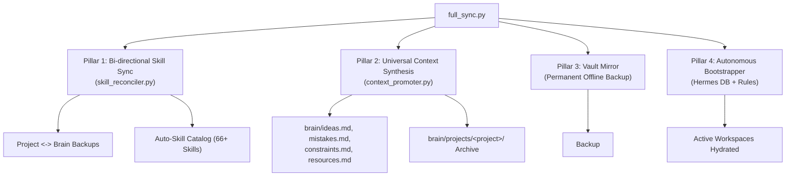

# Full-Sync 3.0: Universal Master Synchronization & Context Synthesis Engine

> [!IMPORTANT]
> ⛔ **EXECUTION-FIRST MANDATE (ZERO-PASSIVE-READING)**:
> Bundled scripts in `scripts/` are **executable software tools**, NOT reading material.
> When this skill is triggered, **EXECUTE the relevant script immediately** via `run_command`.
> **STRICT PROHIBITION**: NEVER call `view_file` on scripts in `scripts/` or explain their source code to the user unless explicitly ordered to edit or debug the script itself.
> Universal scripts can and must be executed from **ANY project workspace** by calling their absolute path:
> `python <BRAIN_ROOT>\.agents\skills\full-sync\scripts\<script_name> ...`

`full-sync` is the master operational heartbeat for the multi-agent ecosystem. It bridges the Central Brain (`<BRAIN_ROOT>`), project workspaces (e.g. `project-web`, `hi`, `sample-project`, `project-audio`, `custom_tools`, `sample-project`, `cult_game`, `sample-project`), and the permanent offline sovereign disaster-recovery vault (`<VAULT_BACKUP_DIR>`).

---

## The 4 Pillars of Full-Sync 3.0



### Pillar 1: Bi-directional Skill Synchronization (`skill_reconciler.py`)
- **Project Discovery**: Automatically maps all registered project directories from `project_map.md` and workspace roots.
- **Merkle Tree Hashing**: Computes normalized SHA-256 hashes (with CRLF/LF normalization) over every skill folder to skip unnecessary writes.
- **Bi-directional Flow**:
  - `Project -> Brain Backup`: Automatically discovers any new or updated skill in `<project>/.agents/skills/<skill>/` and backs it up to `brain/project_skills/<project>/<skill>/`.
  - `Brain -> Project Hydration`: If a registered project skill is missing from a project workspace, automatically hydrates it down from Central Brain.
- **12-Universal-Skill Cap Guard**: Strictly preserves `brain/.agents/skills/` for the 12 core universal powerhouses. Non-core universal candidates are staged in `brain/project_skills/_universal_candidates/`.
- **Automatic Catalog Regeneration**: Upon any skill modification, immediately triggers `auto-skill/scripts/sync_catalog.py`, keeping `skill_registry.json` and `catalog.md` 100% synchronized.

### Pillar 2: Universal Context Synthesis & Promotion (`context_promoter.py`)
- **Markdown AST Block Parsing**: Parses `ideas.md`, `mistakes.md`, `constraints.md`, and `resources.md` into discrete semantic blocks.
- **Universal vs Local Semantic Classifier**:
  - Automatically identifies cross-project invariants, cloud limits, runtime defects, security configurations, and architectural decisions.
  - Distinguishes universal insights from hyper-local component styling (padding, color, margin, local route names).
- **Persistent Signature Deduplication**: Stores SHA-256 signature and title hashes in `projects/.context_promotion_state.json` to guarantee 100% idempotent runs (0 duplicate entries appended on subsequent runs).
- **Monotonic Anti-Wipe Guard**: Guarantees file size never decreases (`len(new_bytes) >= len(old_bytes)`) and commits changes atomically via `.tmp` replacement.
- **Complete Project Archiving**: Archives all raw project context files into `brain/projects/<project>/`.

### Pillar 3: Sovereign Disaster-Recovery Vault Backup (`sync_to_d_agentic.py`)
- Mirrors all universal skills, project skills, rules, and living context files to `<VAULT_BACKUP_DIR>`.
- Re-generates `master_agent_state.md` and `README.md` for 1-command cross-device restoration.

### Pillar 4: Autonomous Project Bootstrapping (`bootstrap_hermes.py`)
- Audits workspaces for `.hermes/project_memory.db`, `file_map.md`, and `AGENTS.md`.
- Hydrates missing project infrastructure automatically using non-destructive sentinel blocks.

---

## Usage & Commands

### 1. Full 4-Pillar Synchronize (Default)
Run from any PowerShell prompt:
```powershell
python <BRAIN_ROOT>\.agents\skills\full-sync\scripts\full_sync.py
```

### 2. Audit / Dry-Run Mode (Zero Disk Writes)
Audit skill diffs and context promotions without mutating any files:
```powershell
python <BRAIN_ROOT>\.agents\skills\full-sync\scripts\full_sync.py --dry-run
```

### 3. Targeted Pillar Operations
```powershell
# Sync only skills and auto-skill catalog
python <BRAIN_ROOT>\.agents\skills\full-sync\scripts\full_sync.py --skills-only

# Synthesize and promote context only
python <BRAIN_ROOT>\.agents\skills\full-sync\scripts\full_sync.py --context-only

# Target a specific project workspace
python <BRAIN_ROOT>\.agents\skills\full-sync\scripts\full_sync.py --project <USER_HOME>\Desktop\project-web

# Sync only the offline <VAULT_BACKUP_DIR> vault
python <BRAIN_ROOT>\.agents\skills\full-sync\scripts\full_sync.py --vault-only
```

---

## When to Run Full-Sync

- **At session start**: Ensures the active project has the latest skills and universal constraints.
- **After authoring or editing a skill**: Automatically indexes the skill in `auto-skill` and backs it up to `project_skills/`.
- **After solving complex bugs or making architectural decisions**: Promotes universal insights to Brain ledgers without manual copy-pasting.
- **Before context compaction or switching machines**: Refreshes offline recovery snapshots in `<VAULT_BACKUP_DIR>`.
