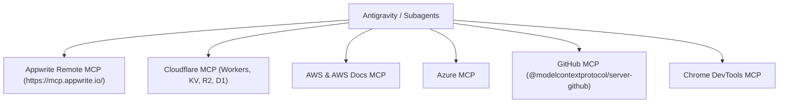

# Multi-Cloud MCP Servers & Tools Reference

> **Tool Mapping and Operational Protocol for Configured Cloud MCP Servers**  
> **Source**: `./.agents\skills\internal-tools\references\cloud_mcp_servers.md`  
> **Configuration**: `C:\Users\User\.gemini\config\mcp_config.json`

---

## 1. Configured Servers & Core Tool Map

### 1. Appwrite Remote MCP (`appwrite`)
* `appwrite_call_tool`: Execute REST operations against Appwrite databases, storage buckets, serverless functions, and user authentication.
* `appwrite_search_docs`: Search live Appwrite developer guides.

### 2. Cloudflare MCP (`cloudflare`)
* **Workers**: `worker_list`, `worker_get`, `worker_put`, `worker_deploy`, `worker_delete`.
* **Storage**:
  * KV: `kv_get`, `kv_put`, `kv_delete`, `kv_list`.
  * R2: `r2_list_buckets`, `r2_list_objects`, `r2_get_object`, `r2_put_object`.
  * D1: `d1_list_databases`, `d1_query`.
* **Workflows & Queues**: `workflow_list`, `queue_send_message`, `queue_list`.

### 3. AWS & AWS Documentation (`aws`, `aws-documentation`)
* `call_aws`: Execute AWS SDK actions against Lambda, S3, IAM, and DynamoDB.
* `search_documentation`, `read_sections`: Live AWS architecture best practices and pricing data.

### 4. Azure MCP (`azure`)
* Manage Azure subscriptions, Flexible PostgreSQL instances (`Standard_B1ms`), and VM start/stop operations.

### 5. GitHub MCP Server (`github-mcp-server`)
* `get_file_contents`, `create_or_update_file`, `push_files`, `search_repositories`, `list_commits`, `create_pull_request`.

### 6. Chrome DevTools MCP (`chrome-devtools-mcp`)
* `navigate_page`, `take_screenshot`, `list_console_messages`, `list_network_requests`, `evaluate_script`: Web app runtime verification, hydration diagnostics, and mobile layout checks.
