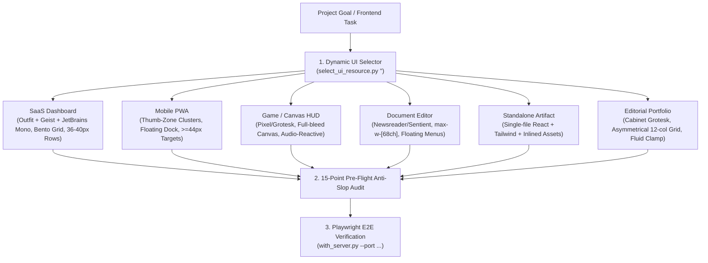

# UI Design Engine (Frontend Architecture & Anti-Slop Orchestrator)

> [!IMPORTANT]
> ⛔ **EXECUTION-FIRST MANDATE (ZERO-PASSIVE-READING)**:
> Bundled scripts in `scripts/` are **executable software tools**, NOT reading material.
> When this skill is triggered, **EXECUTE the relevant script immediately** via `run_command`.
> **STRICT PROHIBITION**: NEVER call `view_file` on scripts in `scripts/` or explain their source code to the user unless explicitly ordered to edit or debug the script itself.
> Universal scripts can and must be executed from **ANY project workspace** by calling their absolute path:
> `python <BRAIN_ROOT>\.agents\skills\ui-design-engine\scripts\<script_name> ...`

> **Unified Design System, Anti-Slop Quality Matrix & Component Bundler for Autonomous AI Agents**  
> **Integrates Hallmark (Together AI, 58 slop tests), Anti-Slop (38 Rules), and Pols.dev Design Laws**

---

## 1. Architectural Overview & Archetype Routing

The `ui-design-engine` acts as a **Mini Auto-Skill for UI**. It eliminates "AI slop" (purple-cyan washes, floating card soup, Inter-only typography, broken mobile viewports) by dynamically selecting design tokens, typography, and geometry based on project archetype:



---

## 2. CLI Command Reference

All utilities reside in `<BRAIN_ROOT>\.agents\skills\ui-design-engine\scripts\`.

### 1. Dynamic UI Resource Selector (Mini Auto-Skill for UI)
Query by domain, keyword, or design challenge to get instant tokens, layout specs, and guideline links:
```powershell
# Query for mobile app patterns:
python <BRAIN_ROOT>\.agents\skills\ui-design-engine\scripts\select_ui_resource.py "mobile touch player"

# Query for high-density SaaS dashboard:
python <BRAIN_ROOT>\.agents\skills\ui-design-engine\scripts\select_ui_resource.py "dashboard"

# Query for anti-slop rules & checklist:
python <BRAIN_ROOT>\.agents\skills\ui-design-engine\scripts\select_ui_resource.py "anti-slop"

# Query for glassmorphism tokens & CSS variables:
python <BRAIN_ROOT>\.agents\skills\ui-design-engine\scripts\select_ui_resource.py "glassmorphism"
```

### 2. Direct Archetype Token Router
Inspects project requirements and emits custom CSS tokens, typography pairings, and layout specs:
```powershell
python <BRAIN_ROOT>\.agents\skills\ui-design-engine\scripts\ui_router.py saas-dashboard
python <BRAIN_ROOT>\.agents\skills\ui-design-engine\scripts\ui_router.py mobile-app
python <BRAIN_ROOT>\.agents\skills\ui-design-engine\scripts\ui_router.py game-canvas
python <BRAIN_ROOT>\.agents\skills\ui-design-engine\scripts\ui_router.py document-editor
python <BRAIN_ROOT>\.agents\skills\ui-design-engine\scripts\ui_router.py interactive-artifact
python <BRAIN_ROOT>\.agents\skills\ui-design-engine\scripts\ui_router.py editorial-portfolio
```
Add `--json` for machine-readable token payloads.

### 3. Scaffold Standalone React + Tailwind Artifact
```powershell
bash <BRAIN_ROOT>\.agents\skills\ui-design-engine\scripts\init-artifact.sh <project-name>
cd <project-name>
```

### 4. Bundle Artifact to Single Self-Contained HTML File
```powershell
bash <BRAIN_ROOT>\.agents\skills\ui-design-engine\scripts\bundle-artifact.sh
```

### 5. Interactive Playwright Verification (with Automated Server Lifecycle)
Starts the local dev server, runs automated Playwright validation, and shuts down the server:
```powershell
python <BRAIN_ROOT>\.agents\skills\ui-design-engine\scripts\with_server.py --server "npm run dev" --port 5173 -- python test_script.py
```

---

## 3. The 15-Point Mandatory Anti-Slop Quality Checklist

Before declaring any frontend change or UI component complete, ensure all 15 gates pass:

1. **No Purple/Cyan Gradients**: Use monochromatic tonal elevation (Slate `#020617` or Zinc `#09090b`) with directional light.
2. **Intentional Typography Pairings**: Display (Outfit, Cabinet Grotesk, Sentient) + Body (Geist Sans, Switzer) + Data (JetBrains Mono). Never default Inter-only.
3. **Mobile Touch Target $\ge 44\text{px}$**: Every button, tab, link, or toggle satisfies `min-h-[44px] min-w-[44px]`.
4. **Zero Viewport Overflow**: 100% responsive down to 375px with zero horizontal scrollbars (`overflow-x-hidden`).
5. **Visible-by-Default Motion**: Never initialize core content at `opacity: 0`; layouts must render legibly if JS/animations fail.
6. **No Hover Boops**: Buttons do not jump vertically on hover; state transitions are tonal (background tint, border glow).
7. **Verified Optical Centering**: Badges, glyphs, and numbers are optically and mathematically centered.
8. **Contrast Ratio Compliance**: All body and muted text meets WCAG 2.1 AA/AAA contrast on dark glass surfaces.
9. **Contained Specular Glows**: Inset top lips (`inset 0 1px 0 rgba(255,255,255,0.12)`), no cut-off blur boxes.
10. **Authentic Copywriting**: Zero robotic AI filler (*"seamlessly"*, *"delve"*, *"unleash"*, *"empower"*).
11. **No Unjustified Cards**: Background content rests directly on the canvas unless discrete/draggable/dismissible.
12. **4px/8px Spatial Rhythm**: All padding, margins, and gaps adhere strictly to 4px/8px multiples.
13. **Tabular Numerics**: Financial metrics, timestamps, and data columns locked to `tabular-nums font-mono`.
14. **Equalized Baselines**: Multi-column comparison cards have buttons anchored to the bottom via `mt-auto`.
15. **Styled Form Primitives**: Native select dropdowns, checkboxes, and text inputs have custom dark glass styling.

---

## 4. Architectural Reference Guides

Detailed specialized engineering guides located in `references/`:
- **[Anti-Slop UI/UX Codex](references/guidelines_anti_slop.md)**: The 12 Deadly Anti-Patterns of AI Slop, 3-Tier Rule System, and 15-Point Pre-Flight Verification Gate.
- **[Design Systems & Dark Glassmorphism](references/guidelines_design_systems.md)**: Liquid Glass tokens, specular borders, non-default typography scales, fluid clamp, and liveliness dials.
- **[The 6 Core UI Archetypes](references/guidelines_archetypes.md)**: Layout blueprints for SaaS dashboards, Mobile PWAs, Game Canvas HUD, TipTap editors, Artifacts, and Portfolios.
- **[UI Registry](references/ui_registry.json)**: Machine-readable JSON catalog of archetypes, tokens, and components.

---

## 5. Embedded Wrapper & Multi-Provider UI Patterns

- **Stealth Control Chrome (`moldbot` Pattern)**: For embedded web wrappers over agent runtimes (e.g. `agy-web-ui`), strictly use clean requested branding (`>_ moldbot`) with zero redundant IDE chrome or brand badges, and keep closed model pickers minimal (e.g. chevron-only `^` trigger revealing active model names only inside the opened popover).
- **Conditional Hardware Capability Disclosure (`syncPlatformCapabilities()`)**: In multi-provider GPU/API studios, strictly isolate tab controls and hide inapplicable options per platform (e.g., hide tunnel flags on Kaggle, hide GPU quantization sliders on pure CPU/Host-RAM nodes).

