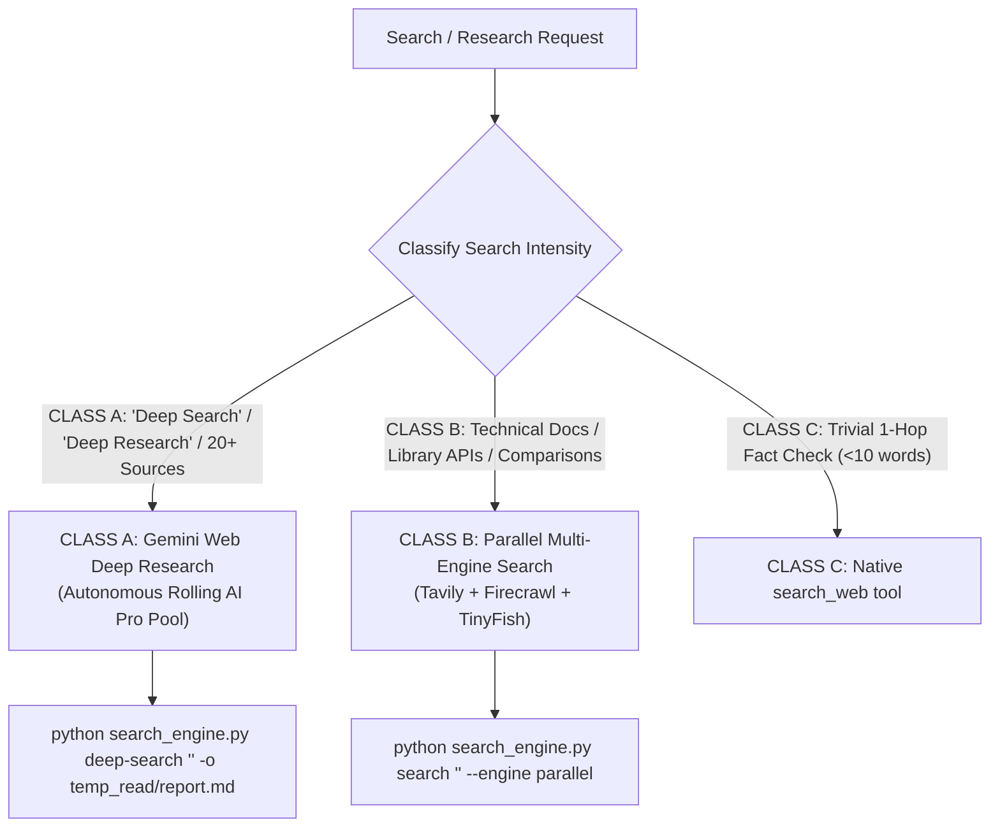

# Web Search & Deep Research Orchestrator

> **Step-0 Project Overlay**: Before executing, check if `<active-project>/.agents/skill_overlays/web-search-orchestrator.md` exists (via `python .agents/skills/auto-skill/scripts/resolve_skill_overlay.py --project <root> --skill web-search-orchestrator`).

> [!IMPORTANT]
> ⛔ **EXECUTION-FIRST MANDATE**: Scripts in `scripts/` are executable software tools, NOT documentation. Never ask the user to run them or read them passively. Execute immediately via shell commands. Never default to native `search_web` for deep research requests!

---

## 1. 3-Class Search Escalation Matrix



| Search Class | Mandated Execution Engine | Tool / CLI Command | Cost & Quota |
|:---|:---|:---|:---|
| **CLASS A: Deep Research** | **Gemini Web `4 Neon` + High** across Chat Deep Research or parallel Task mode (`--task`) | `python .agents/skills/web-search-orchestrator/scripts/search_engine.py deep-search "<topic>" -o temp_read/<name>.md` | 100% Free (Tier 1 Alts First) |
| **CLASS B: Multi-Engine Docs**| **Parallel Tavily + Firecrawl + TinyFish** executed via dedicated subagent (`TypeName='self'`) | `python .agents/skills/web-search-orchestrator/scripts/search_engine.py search "<query>" --engine parallel` | API / Scraping quotas |
| **CLASS C: 1-Hop Fact Check** | **Native `search_web`** | Native tool call | Permitted ONLY for trivial 1-hop checks |

---

## 2. Gemini Web Deep Research ROI & Invariants

- **High-ROI Synthesis**: A single ~half-window run on Gemini Web 4 Neon High generates a comprehensive, 20+ source grounded technical dossier.
- **Subagent Search Isolation**: Class B searches MUST run in a dedicated subagent (`TypeName='self'`) to isolate raw search tokens from the parent conversation.
- **Provider Credentials**: API keys (Tavily, Firecrawl) are resolved dynamically from project environment variables or Central Brain resources. Never hardcode file paths.

---

## 3. Core CLI Commands

```bash
# 1. Class A: Comprehensive 20+ source deep research dossier
python .agents/skills/web-search-orchestrator/scripts/search_engine.py deep-search "<topic>" -o temp_read/research_dossier.md

# 2. Class B: Parallel multi-engine search across Tavily, Firecrawl, and TinyFish
python .agents/skills/web-search-orchestrator/scripts/search_engine.py search "<query>" --engine parallel

# 3. Clean Markdown extraction from target URL
python .agents/skills/web-search-orchestrator/scripts/search_engine.py fetch "<url>"
```

---

## 4. References & Search Guides

- [Multi-Engine Search & Provider Configuration Guide](references/search_engines_guide.md) — Comprehensive guide for Tavily, Firecrawl, TinyFish, and Gemini Deep Research configuration.