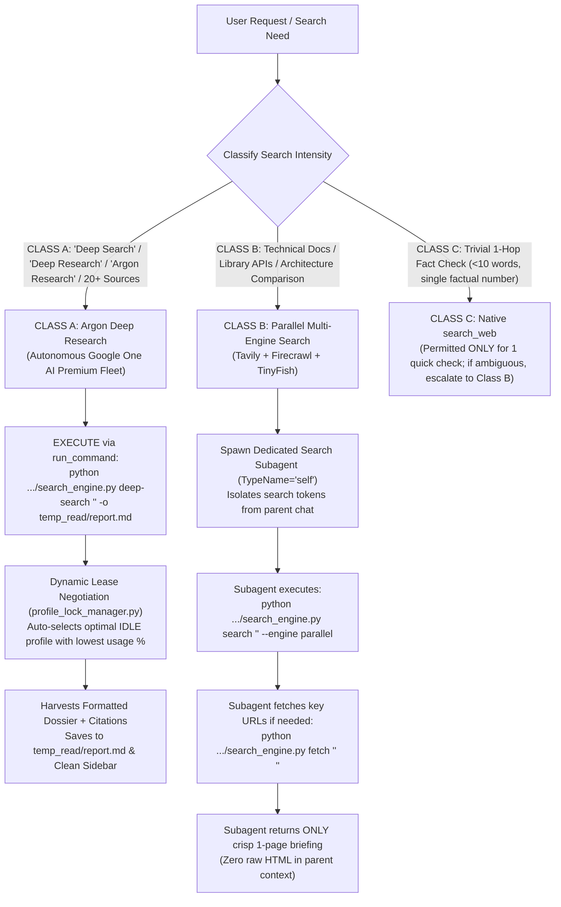

# Web Search & Deep Research Orchestrator

> [!IMPORTANT]
> ⛔ **EXECUTION-FIRST MANDATE (ZERO-PASSIVE-READING & ZERO-NATIVE-SEARCH-DEFAULT)**:
> 1. Bundled scripts in `scripts/` are **executable software tools**, NOT reading material.
> 2. **STRICT PROHIBITION**: NEVER call `view_file` or `read_file` on scripts in `scripts/`. Always execute directly via `run_command`.
> 3. **STRICT PROHIBITION ON PASSIVE NATIVE SEARCH DEFAULTING**:
>    When the user asks for a **"deep search"**, **"deep research"**, **"comprehensive investigation"**, or **"technical comparison"**, agents **MUST NOT** default to the native `search_web` tool. You must execute **Argon Deep Research** or the **Parallel Multi-Engine Search** (`search_engine.py`)!

---

## 1. Autonomous Search Escalation & Routing Protocol

To prevent context bloat and ensure cutting-edge search depth, all searches MUST adhere to this strict escalation matrix:



---

### Search Escalation Decision Matrix

| Search Class | User Trigger Phrases | Mandated Execution Engine | Tool / CLI Command | Cost & Quota |
|---|---|---|---|---|
| **CLASS A: Frontier Deep Research** | *"deep search"*, *"deep research"*, *"search with argon"*, *"comprehensive dossier"*, *"exhaustive comparison"*, *"landscape"* | **Argon Deep Research** (Google One AI Premium Fleet) | `python .../search_engine.py deep-search "<topic>" -o temp_read/<name>.md` | 100% Free (6 Shared AI Pro Accounts) |
| **CLASS B: Multi-Engine Technical** | *"search docs"*, *"how to configure"*, *"latest updates"*, *"GitHub issue for"*, *"library benchmark"* | **Parallel Multi-Engine** (Tavily AI + Firecrawl JS + TinyFish) | `python .../search_engine.py search "<query>" --engine parallel` *(inside search subagent)* | Free API Quota (<2s latency) |
| **CLASS C: Trivial Fact Check** | Single factual question (e.g. *"npm command for X"*, *"current price of Y"*) | **Native `search_web`** | `default_api:search_web` *(1 single query only; never loop)* | Instant (<1s) |

---

## 2. Class A: Autonomous Argon Deep Research (Google One AI Premium Fleet)

When the user asks for a **"deep search"** or **"deep research"**, the agent must trigger **Argon Deep Research**.

### 2.1 Shared Fleet Observability & Dynamic Routing
- All 6 Google One AI Premium profiles (`Profile 14`, `Profile 13`, `Profile 16`, `Profile 7`, `Profile 8`, `Profile 9`) form a shared compute pool.
- **Zero Hardcoding**: NEVER hardcode profiles to projects. The bridge auto-selects the optimal IDLE profile with the lowest usage %.
- **Live Fleet Inspection**:
  ```powershell
  python <BRAIN_ROOT>\.agents\skills\web-search-orchestrator\scripts\search_engine.py deep-search --status
  ```
- **Autonomous Lease Arbitration**:
  Registers an active lease in `bridge_profile_locks.json` with `deep_research=True` (`ttl=900s`, `20s` renewal heartbeat). If Profile A is busy, it auto-negotiates Profile B.
- **Single-Tab Low-RAM Limit**: Reuses the active Gemini tab; never spawns duplicate tabs to preserve host RAM (~3GB free).
- **Auto-Confirm & Clean Retention**: Drives `gemini.google.com/app`, confirms the Deep Research plan card, long-polls 20+ sources, harvests structured Markdown with deduplicated citations, and saves the completed dossier to `<workspace>/temp_read/`.

### 2.2 CLI Execution Commands for Class A

```powershell
# 1. Standard Autonomous Deep Research (Auto-selects optimal idle profile, saves to temp_read/)
python <BRAIN_ROOT>\.agents\skills\web-search-orchestrator\scripts\search_engine.py deep-search "Exhaustive comparison of pgvector vs Milvus vs Qdrant in 2026." -o temp_read/vector_db_deep_research.md

# 2. Deep Research with Specific Technical Vectors & Goals
python <BRAIN_ROOT>\.agents\skills\web-search-orchestrator\scripts\search_engine.py deep-search "Next.js 16 Server Actions architecture" --goals "Server actions security, CSRF protection, streaming SSR performance benchmarks" -o temp_read/nextjs16_research.md

# 3. Via Dedicated Runner (Identical shared fleet engine)
python <BRAIN_ROOT>\.agents\skills\web-search-orchestrator\scripts\gemini_deep_research.py "Post-Quantum Cryptography implementations in Python" -o temp_read/pqc_report.md
```

---

## 3. Class B: Parallel Multi-Engine Search & Subagent Isolation

> [!IMPORTANT]
> **MANDATORY CONTEXT ISOLATION RULE**:
> Conducting multi-page web searches or crawling dynamic SPAs consumes thousands of context tokens.
> **ALWAYS spawn a dedicated search subagent (`TypeName='self'`)** for Class B searches so the main session context stays pristine and sharp.

### 3.1 Subagent Dispatch Template

Call `invoke_subagent` with `TypeName='self'`:
```python
invoke_subagent(
    TypeName="self",
    Role="Web Research Specialist",
    Prompt="""You are a dedicated Web Research Specialist subagent.
Your task is to research: <RESEARCH_QUERY>

EXECUTION INSTRUCTIONS:
1. DO NOT call native search_web in a loop.
2. Execute the multi-engine parallel search CLI tool immediately:
   python <BRAIN_ROOT>\.agents\skills\web-search-orchestrator\scripts\search_engine.py search "<QUERY>" --engine parallel
3. If specific official documentation or deep technical pages need full reading, fetch them in clean Markdown:
   python <BRAIN_ROOT>\.agents\skills\web-search-orchestrator\scripts\search_engine.py fetch "<URL1>" "<URL2>"
4. Synthesize your findings into a high-density, 1-page technical briefing with exact parameters, configuration snippets, and verified facts.
5. Return ONLY the synthesized briefing. Do not dump raw search logs or bloated HTML."""
)
```

### 3.2 CLI Execution Commands for Class B

All utilities are located in `<BRAIN_ROOT>\.agents\skills\web-search-orchestrator\scripts\`.

```powershell
# 1. High-Speed Parallel Multi-Engine Search (Tavily AI + Firecrawl JS + TinyFish simultaneously)
python <BRAIN_ROOT>\.agents\skills\web-search-orchestrator\scripts\search_engine.py search "<query>" --engine parallel

# 2. Deep Semantic Q&A Search (Tavily Only)
python <BRAIN_ROOT>\.agents\skills\web-search-orchestrator\scripts\search_engine.py search "<query>" --engine tavily --max-results 8

# 3. Full JavaScript Stealth Scrape & Search (Firecrawl Only - Great for SPAs & React/Vue docs)
python <BRAIN_ROOT>\.agents\skills\web-search-orchestrator\scripts\search_engine.py search "<query>" --engine firecrawl

# 4. Domain-Restricted Search
python <BRAIN_ROOT>\.agents\skills\web-search-orchestrator\scripts\search_engine.py search "<query>" --domain "docs.anthropic.com"

# 5. Clean Page Markdown Fetch (Parallel multi-URL supported)
python <BRAIN_ROOT>\.agents\skills\web-search-orchestrator\scripts\search_engine.py fetch "<url1>" "<url2>" --engine auto

# 6. Local Headless JS-Crawler (Playwright / Crawl4AI - Zero Cost)
python <BRAIN_ROOT>\.agents\skills\web-search-orchestrator\scripts\crawl_distill.py "<url>" --max-lines 80

# 7. HTML-to-Markdown Distiller (Strips boilerplate, cookie banners, navigation links)
python <BRAIN_ROOT>\.agents\skills\web-search-orchestrator\scripts\content_distiller.py "<path_to_html_or_url>"
```

---

## 4. API Keys & Configuration Ledger

All API keys are centralized in `~/.gemini/antigravity/search_keys.json` (outside Git):
- `TINYFISH_API_KEY`: Configured via TinyFish CLI & local key store.
- `TAVILY_API_KEY`: Configured via central store & `project-web/.env.local`.
- `FIRECRAWL_API_KEY`: Configured via central store & `project-web/.env.local`.
- `Google One AI Premium Accounts`: 6 pre-authenticated Chrome profiles via trusted CDP bridge (`http://127.0.0.1:9229`). Zero API keys required.

---

## 5. Summary of Agent Responsibilities

1. **Stop Defaulting to `search_web`**: If the user asks for "deep search", "comprehensive analysis", or complex documentation, do NOT call `search_web`.
2. **Execute Directly**: Run `search_engine.py deep-search` or spawn a subagent to run `search_engine.py search ... --engine parallel`.
3. **Deliver to `temp_read/`**: Write large research dossiers to `<active_project>/temp_read/` and summarize key findings concisely in chat.
4. **Cloud IP Geo-Lock & Temporal Anchor Guardrail**: When running web search (e.g. DuckDuckGo) inside cloud datacenter nodes (Colab/GCP `europe-west4`), force `region="wt-wt"` to prevent localized foreign-language results, inject `datetime.now()` into search/agent prompts to eliminate 2023 cutoff query drift, and wire a Google News RSS fallback.


### 2.1 Direct Argon Consultation & 2-Tier Failover in Search Workflows
When synthesizing search results, evaluating architecture options discovered online, or running **Argon Deep Research**:
```powershell
# 1. Argon Deep Research (20+ Sources Grounded Report; auto-deletes chat from sidebar & audits quota):
python <BRAIN_ROOT>\.agents\skills\deep-thinking\scripts\consult_argon.py "<research_topic>" --deep-research -o temp_read/deep_research_report.md

# 2. Argon High-Thinking Synthesis on Scraped Context Files (-f attaches file chip, auto-purges sidebar chat):
python <BRAIN_ROOT>\.agents\skills\deep-thinking\scripts\consult_argon.py "Synthesize and compare the findings in the attached scraped docs." -f temp_read/scraped_docs.md -o temp_read/argon_synthesis.md

# 3. Tier-2 Vertex AI API Fallback (ONLY if all 6 browser profiles hit quota limit OR user explicitly requests API):
python <BRAIN_ROOT>\.agents\skills\deep-thinking\scripts\consult_argon.py "Synthesize findings" -f temp_read/scraped_docs.md --api -o temp_read/argon_api_synthesis.md
```
