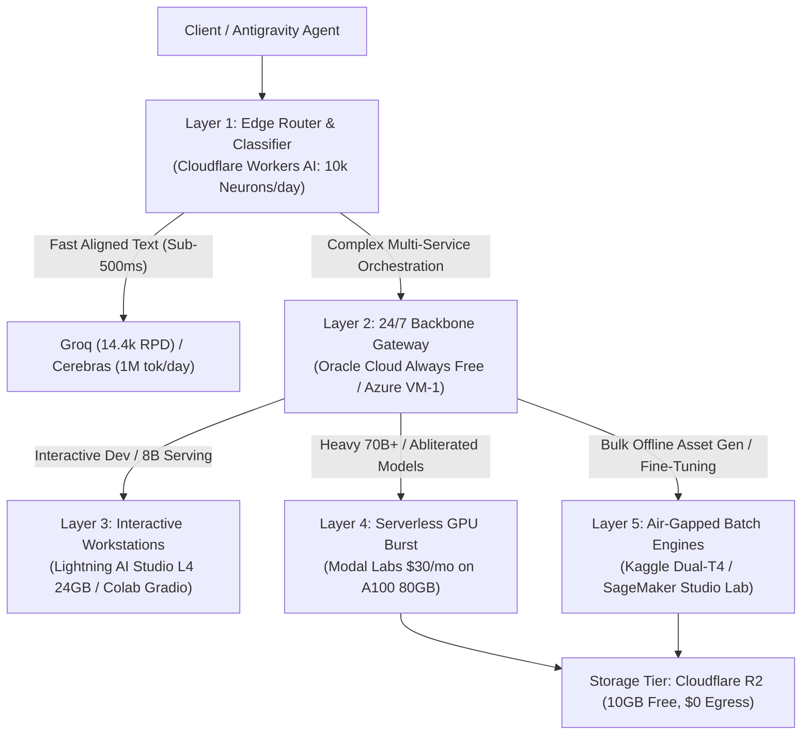
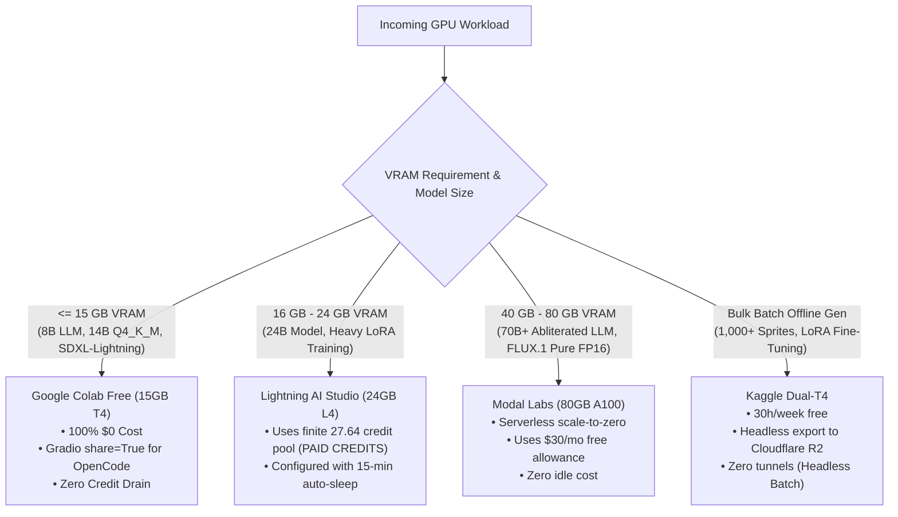

# Cloud Compute Platforms & Zero-Cost Multi-Cloud Architecture

> **Master Forensic Reference & Compliance Matrix for Cloud Compute, GPU Notebooks, and Inference Providers**  
> **Source**: Audited Terms of Service, Quota Cycles, and Technical Capabilities (September 2026)  
> **Primary Rule**: Never violate Terms of Service; strictly adhere to the Air-Gapped Notebook Invariant and Native Ingress Policy.

---

## 1. Executive Platform Comparison Matrix

| Platform | Recurring vs. One-Time | GPU Model & VRAM | Session Timeout | Native Port Forwarding | Tunneling Allowed | Primary Ban Risk |
|---|---|---|---|---|---|---|
| **AWS SageMaker Studio Lab** | 🛑 **CLOSED TO NEW USERS** (Legacy accounts only) | NVIDIA Tesla T4 (16 GB) | 4-hour hard cap (GPU); 12-hour (CPU) | No | No (Violates AWS AUP) | Reverse tunneling (`ngrok`/`cloudflared`), background keepalive scripts |
| **Lightning AI** | 🛑 **ONE-TIME ONBOARDING GRANT** (5 free + 25 on card verification; **NO monthly renewal**) | NVIDIA L4 (24 GB) or T4 (16 GB) | Dynamic (credit-depleted) or configurable auto-sleep (15–30 min idle) | Yes (Native Port Forwarding & Web App plugins) | Discouraged / Monitored (Bypassing native access) | Cryptomining, unauthorized network scanning, DDoS |
| **Modal** | Permanently recurring ($30/month credit) | T4, L4, A10G (24 GB), A100 (40/80 GB), H100 (80 GB), B200/B300 | Serverless scale-to-zero; max 24 hours per function call | Yes (Native `@modal.web_endpoint` / `@modal.asgi_app`) | N/A (Direct public HTTPS endpoints built-in) | Cryptomining, brute-forcing, hosting malicious/unlawful content |
| **Paperspace Gradient** | Free tier (Shared Free-GPU pool availability) | Quadro M4000/P4000 (8 GB) | 6-hour hard cap per session; 15–30 min idle shutoff | No | No | Proxy tunneling, game hosting, unattended automation |
| **Google Colab** | Free tier (Dynamic rolling cool-off: 12–72 hours) | NVIDIA Tesla T4 (15 GB) | 12-hour absolute max; 30–90 min idle disconnect | No (Only built-in UI output or Gradio `share=True`) | Strictly Forbidden (Automated kill switches) | SSH tunnels, `cloudflared`/`ngrok`, game servers, deepfakes, automated keepalives |
| **Hugging Face Spaces / ZeroGPU** | Permanently recurring (Dynamic daily quota / 120s burst) | Shared NVIDIA A100 (40/80 GB) or L4 | 120-second max execution burst per inference call | Yes (Native web application hosting: Gradio/FastAPI) | Discouraged / Monitored | Circumventing UI with automated scraping, DDoS, non-ML proxying |
| **GitHub Codespaces** | Permanently recurring (60 core-hours/month) | None (CPU only: 2–4 vCPU, 4–8 GB RAM) | Configurable auto-suspend (default 30 min idle) | Yes (Native GitHub Port Forwarding: Private/Public) | Monitored | Cryptomining, proxy routing, running production daemons |
| **Oracle Cloud Always Free** | Permanently recurring (Uncapped 24/7 uptime) | None (4 Ampere ARM cores, 24 GB RAM, 200 GB SSD) | None (Continuous 24/7/365 execution) | Yes (Full root network stack, Security Lists/IPTables) | Yes (Self-managed network stack) | Cryptomining, network spam, resource abandonment (<15% CPU for 7 days triggers reclamation) |
| **Cloudflare Workers AI** | Permanently recurring (10,000 Neurons/day free) | Edge-distributed GPUs (Serverless inference) | Sub-second edge execution; scale-to-zero | Yes (Native edge HTTPS endpoints via Cloudflare) | N/A (Edge-native routing) | Rapid-fire prompt injection, DDoS, bypassing WAF |
| **Groq / Cerebras / OpenRouter** | Permanently recurring (Tiered daily/minute rate limits) | LPU / CS-3 Wafer Engine / Clustered H100s | Sub-second API request/response cycle | Yes (Native OpenAI-compatible REST APIs) | N/A (Pure API services) | Exceeding burst RPM/RPD, distributed key recycling, terms abuse |
| **Kaggle** | Permanently recurring (30 GPU-hours/week, Sunday reset) | 2x NVIDIA Tesla T4 (30.7 GB) or 1x P100 (16 GB) | 12-hour batch run cap; 40-minute idle disconnect | No | Strictly Forbidden (Automated ban trigger) | Reverse tunnels (`cloudflared`, `ngrok`, `playit.gg`), game servers (Minecraft/Steam), keepalive loops |

---

## 2. In-Depth Platform Breakdown & Operating Parameters

- **Status**: 🛑 **OFFICIALLY CLOSED TO NEW REGISTRATIONS** (as documented in AWS DG `studio-lab-availability-change.html`). Only legacy registered accounts can log in.
- **Free Quotas & Reset Cycles (Legacy Accounts Only)**: 4 hours of GPU runtime per 24-hour rolling window; 12 hours of CPU runtime per 24 hours. Resets exactly 24 hours after compute stops. 15 GB persistent EBS.
- **Hardware Architecture**: Single NVIDIA Tesla T4 (16 GB VRAM), 4 vCPUs, 16 GB system RAM.
- **Why "Amazon SageMaker Studio Free Tier" in AWS Console is a DANGEROUS TRAP**:
  - AWS promotional banner redirects users to "Amazon SageMaker Studio (free tier)".
  - **ZERO GPU INCLUDED**: The 2-month AWS Free Tier only includes `ml.t3.medium` instances (**CPU-ONLY**, 2 vCPUs, 4 GB RAM). Any GPU instance (`ml.g4dn.xlarge`) is billed from minute one (~$0.736/hr).
  - **Storage Costs**: Spinning up SageMaker Studio provisions Amazon EFS storage ($0.30/GB/month) and VPC interfaces, incurring direct AWS credit card charges.
  - **Strict Policy**: Primary AWS account must remain restricted to **AWS Lambda ONLY**. Never spin up SageMaker Studio in the AWS Management Console.

---

### 2. Lightning AI Studios
- **Free Quotas & Reset Cycles**: 🛑 **ONE-TIME ONBOARDING GRANT ONLY** (Verified via live transaction ledger: 5 free credits on signup + 25 credits on card verification = $30.00 total one-time). **DOES NOT REFRESH MONTHLY** on free tier (zero credits added on the 1st of subsequent months). Paid Pro plan costs $20/mo for ~30–40 credits.
- **Hardware Architecture**:
  - NVIDIA L4: 24 GB GDDR6 VRAM (Ada Lovelace, native FP8 tensor cores). Costs ~$0.70/credit-hr (~39 hours total on 27.64 balance).
  - Tesla T4: 16 GB GDDR6 VRAM. Costs ~$0.68/credit-hr (~40 hours total).
  - Persistent Studio Storage: 10 GB default workspace.
- **Session Lifecycles & Persistence**: Auto-sleep configurable down to 15 minutes of inactivity. Hard session limit: 4 hours continuous run before requiring a restart. Files and dependencies persist across reboots.
- **Network Ingress & Tunneling Policies**: **Native port forwarding built-in**. Studios generate secure URLs (`*.lightning.ai`) for any listening TCP port (e.g. 8080, 7860). Using reverse tunnels is unnecessary and violates platform heuristics.
- **Optimal Zero-Cost Strategy**: **STRICT EMERGENCY RESERVE**. Treat the remaining ~27.64 credits as finite cash. **NEVER** run small models or background loops here. Reserve exclusively for one-off tasks requiring 24 GB VRAM on an L4 that free T4s cannot handle.

---

### 3. Modal Labs
- **Free Quotas & Reset Cycles**: **$30.00 / month recurring credits** on the Starter Tier (refreshes on the 1st). True serverless billing per millisecond. Zero cost when idle ($0/sec). 1 TiB volume storage free.
- **Hardware Architecture**:
  - NVIDIA A100 (80 GB SXM4): $0.000694 / sec (~$2.50 / hour).
  - NVIDIA A100 (40 GB PCIe): $0.000583 / sec (~$2.10 / hour).
  - NVIDIA A10G (24 GB): $0.000306 / sec (~$1.10 / hour).
  - NVIDIA L4 (24 GB): $0.000222 / sec (~$0.80 / hour).
  - NVIDIA T4 (16 GB): $0.000164 / sec (~$0.59 / hour).
  - NVIDIA H100 (80 GB): $0.001097 / sec (~$3.95 / hour).
- **Session Lifecycles & Persistence**: Serverless scale-to-zero. Functions spin up in 2–5 seconds (warm) or 15–30 seconds (cold container with weights cached in `@modal.volume`). Execution limit: up to 24 hours per container.
- **Network Ingress & Tunneling Policies**: **100% compliant native ingress via `@modal.web_endpoint` or `@modal.asgi_app`**. Provides public HTTPS endpoints with automatic SSL, request queuing, and concurrency management.
- **Optimal Zero-Cost Strategy**: **Dedicated burst engine for 70B+ Abliterated LLMs (FP8 / AWQ) and FLUX.1-schnell image synthesis**.
  - On an A100 (80 GB), an inference call taking 20 seconds costs ~$0.022.
  - With $30/month, you can execute **~1,360 heavy 70B reasoning calls/month** at $0 out-of-pocket cost.

---

### 4. Paperspace Gradient (Free Tier)
- **Free Quotas & Reset Cycles**: Access to shared Free-GPU instances (Free-GPU-M4000, Free-GPU-P4000, Free-GPU-K80). Dynamic availability based on datacenter load.
- **Hardware Architecture**: Quadro M4000 / P4000 (8 GB VRAM, Pascal/Maxwell), 8 vCPUs, 30 GB RAM.
- **Session Lifecycles & Persistence**: 6-hour hard session cap. Auto-shutdown after 15–30 minutes idle. 5 GB free persistent storage.
- **Network Ingress & Tunneling Policies**: Outbound HTTP/HTTPS allowed. Inbound traffic blocked. Reverse tunneling triggers abuse alerts.
- **Optimal Zero-Cost Strategy**: Auxiliary CPU data processing, dataset cleaning, and lightweight feature extraction.

---

### 5. Google Colab (Free Tier)
- **Free Quotas & Reset Cycles**: Dynamic compute units based on rolling availability. Cool-off period ranges from 12 to 72 hours when exhausted.
- **Hardware Architecture**: Single NVIDIA Tesla T4 (15 GB VRAM), 2 vCPUs, 12.7 GB system RAM.
- **Session Lifecycles & Persistence**: Max 12 hours wall-clock; 30–90 min idle disconnect. Ephemeral storage (wiped on disconnect).
- **Network Ingress & Tunneling Policies**:
  - **Strictly Banned**: SSH tunnels (`cloudflared`, `ngrok`, `gotty`), game servers, cryptocurrency mining, deepfakes, automated keepalive JavaScript scripts.
  - **Permitted**: Native Gradio public links (`demo.launch(share=True)`), Google Drive synchronization.
- **Optimal Zero-Cost Strategy**: Headless, standalone batch generation or quick interactive visual testing with Gradio `share=True`.

---

### 6. Hugging Face Spaces & ZeroGPU
- **Free Quotas & Reset Cycles**: Free dynamic GPU allocation via ZeroGPU. Each request is allocated a slice of an A100 (40/80 GB) or L4 for up to 120 seconds. Daily quotas reset every 24 hours.
- **Hardware Architecture**: Shared NVIDIA A100 (40 GB or 80 GB) or L4.
- **Session Lifecycles & Persistence**: Ephemeral GPU attachment. Code runs in a persistent CPU container (free tier: 2 vCPU, 16 GB RAM).
- **Network Ingress & Tunneling Policies**: Native web application hosting (Gradio, Streamlit, Docker). Public HTTPS endpoints provided natively. Automated scraping or non-ML tunneling is banned.
- **Optimal Zero-Cost Strategy**: Public-facing lightweight ML demos, interactive tools, or Gradio UI endpoints.

---

### 7. GitHub Codespaces
- **Free Quotas & Reset Cycles**: 60 core-hours per calendar month for personal GitHub accounts (resets on 1st of month). Equivalent to 30 hours on 2-core machine, or 15 hours on 4-core machine. 15 GB free storage.
- **Hardware Architecture**: Virtual CPU environments (2-core: 2 vCPU, 8 GB RAM, 32 GB SSD; 4-core: 4 vCPU, 16 GB RAM, 32 GB SSD). Zero GPU.
- **Session Lifecycles & Persistence**: Auto-suspend after 30 minutes of idle time. State, packages, and storage persist across suspensions.
- **Network Ingress & Tunneling Policies**: **Native Port Forwarding built-in**. Forward any local listening port to Private (authenticated) or Public (anonymous) HTTPS URL.
- **Optimal Zero-Cost Strategy**: Cloud development environment, code editing, running automated CI/CD validation scripts, and testing Node.js / Python API servers.

---

### 8. Oracle Cloud Always Free (OCI)
- **Free Quotas & Reset Cycles**: Permanently 100% free with no monthly expiration.
  - Compute: Up to 4 ARM Ampere A1 cores and 24 GB RAM (can be 1 large VM or split into up to 4 smaller VMs).
  - Storage: 200 GB total boot/block volume storage.
  - Network: 10 TB free monthly outbound data transfer. Static public IPv4 address included for free.
- **Hardware Architecture**: Ampere Altra ARM64 processors.
- **Session Lifecycles & Persistence**: Continuous 24/7/365 execution. Instances are never stopped unless resource utilization falls below 15% CPU for 7 consecutive days (inactivity reclamation).
- **Network Ingress & Tunneling Policies**: Full root access. Open any port via OCI Virtual Cloud Network (VCN) Security Lists and `iptables`. No third-party tunnel needed.
- **Optimal Zero-Cost Strategy**: **The permanent 24/7 central backbone**. Hosts the central FastAPI API Gateway, Caddy reverse proxy, Qdrant/pgvector database, and local 24/7 8B CPU inference (via `llama.cpp` ARM NEON optimizations @ 8–12 tokens/sec).

---

### 9. Cloudflare Workers AI
- **Free Quotas & Reset Cycles**: **10,000 Neurons per day permanently free** (resets at 00:00 UTC daily).
- **Hardware Architecture**: Globally distributed Cloudflare edge serverless GPUs running optimized quantized models.
- **Session Lifecycles & Persistence**: Instant cold start (<100ms), executes at edge, scales to zero.
- **Network Ingress & Tunneling Policies**: Native Cloudflare edge routing via Anycast HTTPS.
- **Optimal Zero-Cost Strategy**: **Edge routing, sentiment classification, intent parsing, and BGE text embeddings** (`@cf/baai/bge-small-en-v1.5`). Zero latency overhead.

---

### 10. Groq, Cerebras & OpenRouter (Free Inference APIs)
- **Free Quotas & Reset Cycles**:
  - **Groq**:
    - `llama-3.1-8b-instant`: 14,400 requests/day, 30 requests/min, 20,000 tokens/min.
    - `llama-3.3-70b-versatile`: 1,000 requests/day, 30 requests/min, 6,000 tokens/min.
  - **Cerebras**:
    - 1,000,000 tokens/day free, 30 requests/min, 60,000 tokens/min. Ultra-fast CS-3 wafer engine (>1,800 tokens/sec).
  - **OpenRouter Free Pool**:
    - Models with `:free` suffix (`nemotron-3-super-120b`, `qwen-2.5-72b`, etc.): 20–50 requests/min, rolling dynamic limits.
- **Session Lifecycles & Persistence**: Pure REST API calls. Zero hosting required.
- **Optimal Zero-Cost Strategy**: **Primary high-speed aligned text generation layer**. Handles 90% of user conversational queries and coding prompts with sub-second latency.

---

## 3. The 5-Layer Multi-Cloud Zero-Cost Architecture

### Layer 1: Edge Routing & Rapid Classification
- **Providers**: Cloudflare Workers AI + Cerebras + Groq.
- **Cost**: $0.00 / month.
- **Function**: Classifies inbound requests, extracts metadata, runs embedding similarity searches, and answers simple/aligned conversational queries.

### Layer 2: 24/7 Backbone API Gateway & Database
- **Providers**: Oracle Cloud Always Free (4 ARM cores, 24 GB RAM) or Azure VM-1 (Cloudflare Tunnel) + Azure PostgreSQL (Free B1ms).
- **Cost**: $0.00 / month.
- **Function**: Central authentication, rate limit tracking, prompt caching, request deduplication, and routing between downstream GPU tiers.

### Layer 3: Interactive Web Dev & 8B Model Experimentation
- **Providers**: Lightning AI Studios (15 credits/mo, native port forwarding) + Google Colab (Gradio `share=True`).
- **Cost**: $0.00 / month.
- **Function**: Interactive development, testing new model architectures, running intermediate 8B models (Llama 3.1 8B, Qwen 2.5 7B) with direct browser access.

### Layer 4: Heavy 70B+ Frontier & Abliterated Model Bursts
- **Providers**: Modal Labs ($30/mo free recurring credit on A100 80GB / H100).
- **Cost**: $0.00 / month (utilizes $30 free allowance for ~1,360 calls/mo).
- **Function**: Runs unaligned/abliterated 70B models (e.g. `Llama-3.3-70B-Instruct-Abliterated`, `Qwen-2.5-72B-Abliterated`) and FLUX.1-schnell image generation. Uses native `@modal.web_endpoint` with scale-to-zero.

### Layer 5: Offline Batch Asset Generation & Quantization
- **Providers**: Kaggle (30 GPU-hrs/week, 2x T4) + AWS SageMaker Studio Lab (4h/day T4).
- **Cost**: $0.00 / month.
- **Function**: Strictly headless, non-networked batch workloads. Runs batch LoRA training, mass game sprite generation, and GGUF/AWQ model quantization. Outputs are written locally and pushed to Cloudflare R2 or Hugging Face repository upon completion.

---

## 4. Workload Routing & VRAM Decision Tree

---

## 5. Anti-Ban Hard Invariants (Zero-Tolerance Rules)

1. **Air-Gapped Notebook Invariant**:
   - Interactive notebook environments (Kaggle, Colab, SageMaker Studio Lab) must **NEVER** run reverse tunneling software (`cloudflared`, `ngrok`, `playit.gg`, `localtunnel`).
   - Notebooks must **NEVER** run game servers (Minecraft, Steam, Palworld) or continuous TCP/UDP daemons.
   - Notebooks must run strictly as **batch engines**: load script -> process data -> export artifacts to object storage -> gracefully terminate.

2. **Native Port Forwarding Only**:
   - For interactive web applications, use **ONLY** platforms with native, first-party port exposure (Lightning AI Studios native port forward, GitHub Codespaces port forwarding, Modal `@modal.web_endpoint`, or Gradio `share=True`).

3. **Scale-to-Zero Verification**:
   - Serverless compute (Modal, Lambda) must explicitly implement timeout guards (`timeout=120`, `keep_warm=0`) to guarantee containers do not linger when requests end.

4. **Resource Quota Pre-Verification**:
   - Never initiate long-running tasks without inspecting quota availability. Verify reset dates and monitor remaining hours/credits.
